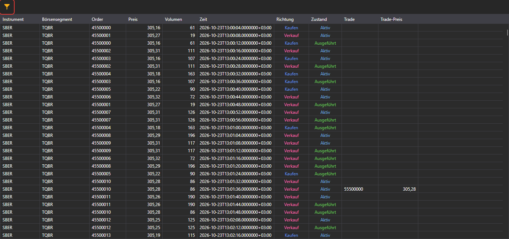

# Orderprotokoll

Die Komponente **Orderprotokoll** ist eine Tabelle mit Orders, die vollständige Informationen über alle Orders für die ausgewählten Instrumente anzeigt.

**Orderprotokoll** verfügt über einen Filter zur Auswahl der benötigten Instrumente.

## Empfohlene Inhalte

[Marktdatenspeicher](../../market_data_storage.md)
