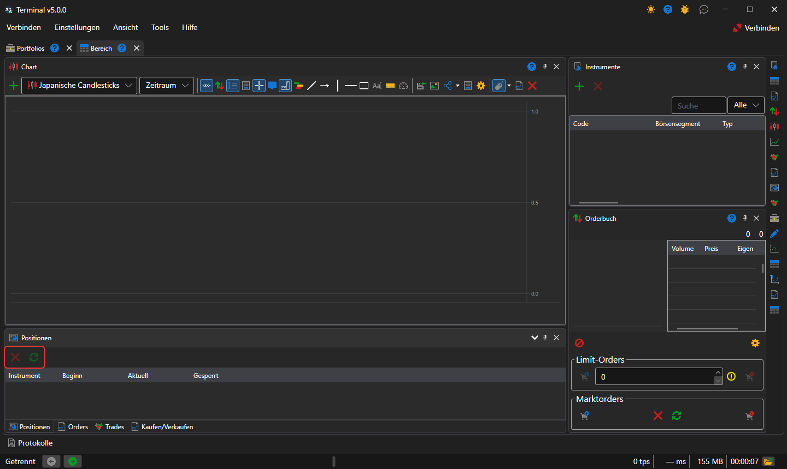

# Positionen

Die Komponente **Positionen** ist eine Tabelle der aktuellen Positionen nach Instrumenten und Portfolios: Volumen, Durchschnittspreis, Gewinn und Verlust.

Über der Tabelle befinden sich die Schaltfläche **Position schließen** — eine Marktorder, die die ausgewählte Position auf null bringt — und die Schaltfläche **Position umkehren** — eine Marktorder über das doppelte Volumen der Position, nach der die Position gleich groß ist, aber in die andere Richtung zeigt. Die Zeile einer Position kann auf ein Ticket [Kaufen/Verkaufen](buy_sell.md) gezogen werden: Das Ticket übernimmt ihr Instrument und Portfolio.

## Siehe auch

[Positionen](../../../designer/user_interface/components/positions.md)

[Kaufen/Verkaufen](buy_sell.md)
