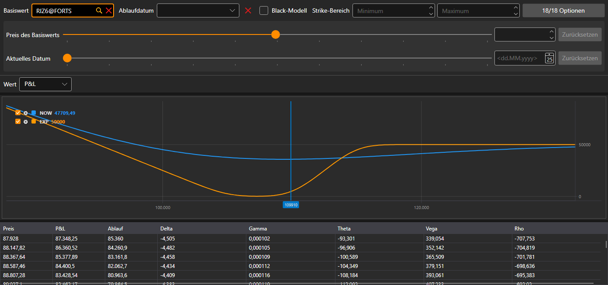

# Positionen (Optionen)

**Positionen (Optionen)** ist eine grafische Darstellung der Optionsposition: wie ihre Kennzahl vom Preis des Basiswerts abhängt.

Die Optionen werden mit demselben Filter ausgewählt wie im [Optionsdesk](option_desk.md): Basiswert, Ablaufdatum, Strike-Bereich und die Optionen selbst. Die „Was wäre, wenn“-Berechnung unter dem Filter zeigt die Position bei einem anderen Preis des Basiswerts und zu einem anderen Datum.

In der Liste **Wert** wird ausgewählt, was dargestellt wird: **P&L**, **Delta**, **Gamma**, **Theta**, **Vega** oder **Rho**. Unter dem Chart befindet sich eine Tabelle der Werte nach Preisen des Basiswerts: **Preis**, der P&L jetzt, der P&L zum **Ablauf** und die Griechen.

## Empfohlene Inhalte

[Optionsdesk](option_desk.md)
