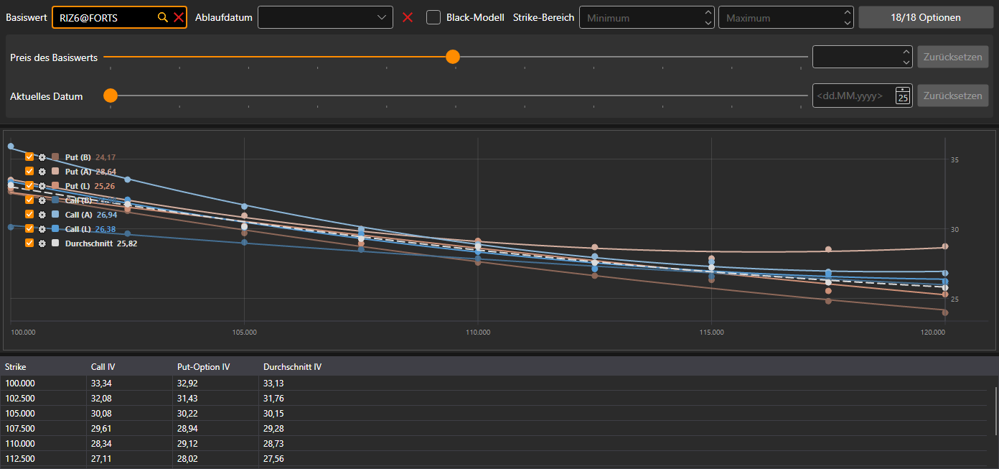

# Smile-Volatilität

Die Komponente **Smile-Volatilität** ist eine grafische Darstellung des erwarteten Volatilitätsniveaus für Optionen mit demselben Basiswert und unterschiedlichen Strikes.

Die Optionen werden mit demselben Filter ausgewählt wie im [Optionsdesk](option_desk.md): Basiswert, Ablaufdatum, Strike-Bereich und die Optionen selbst.

Das Chart zeigt sieben Kurven: die implizite Volatilität der Calls und Puts zum besten Geldkurs, zum besten Briefkurs und zum Preis des letzten Trades sowie gestrichelt den **Durchschnitt** der Volatilität von Call und Put an jedem Strike. Unter dem Chart befindet sich eine Tabelle: **Strike**, die Volatilität von **Call** und **Put-Option** (zum Preis des letzten Trades oder, wenn es keine Trades gab, zum besten Geld- oder Briefkurs) und ihr **Durchschnitt**.

## Empfohlene Inhalte

[Optionsdesk](option_desk.md)

[Positionen (Optionen)](positions_options.md)
