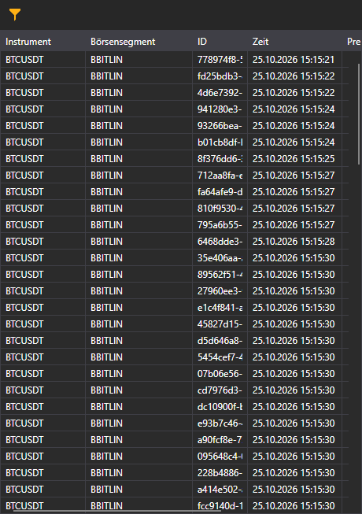

# Trade-Feed

Der Trade-Feed in Terminal zeigt Marktgeschäfte für ausgewählte Instrumente. Die gemeinsame Anleitung zu Tick-Trades erklärt den Instrumentenfilter dieser Komponente.

Siehe

[Tick-Trades](../../../designer/user_interface/components/tick_trades.md)
