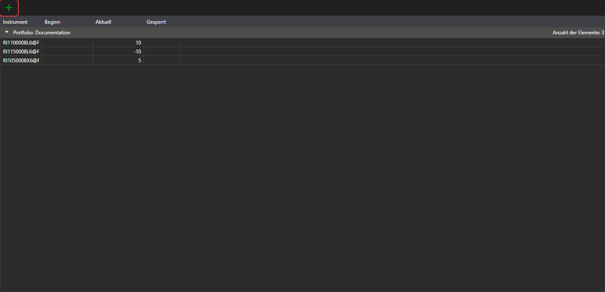

# Portfolios

Das Panel **Portfolios** zeigt Portfoliodaten und die zugehörigen Positionen. Es wird mit dem Eintrag **Ansicht → Portfolios** des [Hauptmenüs](ribbon.md) geöffnet.

Die Schaltfläche  legt eine Position an, ihr Dropdown-Menü ein Portfolio oder eine Position. Ein Doppelklick auf eine Zeile öffnet die Position zur Bearbeitung.

Das Menü, das sich mit einem Rechtsklick auf eine Zeile öffnet, enthält außer den allgemeinen Einträgen der [Tabellen](tables.md):

- **Bearbeiten** — die Position zur Bearbeitung öffnen;
- **Position schließen** — eine Marktorder platzieren, die die Position schließt;
- **Position umkehren** — eine Marktorder über das doppelte Volumen der Position platzieren, damit die Position ihre Richtung wechselt;
- **Abheben** — Mittel vom Handelsplatz abheben: Im Fenster werden der Betrag und die Daten für die Auszahlung angegeben. Der Eintrag ist für eine positive Position in einem Vermögenswert verfügbar, wenn die Verbindung des Portfolios Auszahlungen unterstützt;
- **Null-Salden ausblenden** — Positionen mit einem Saldo von null nicht anzeigen.

Mehr über Portfolios, Positionen und ihre Bearbeitung finden Sie in der gemeinsamen Anleitung: [Portfolios](../../designer/user_interface/portfolios.md).
