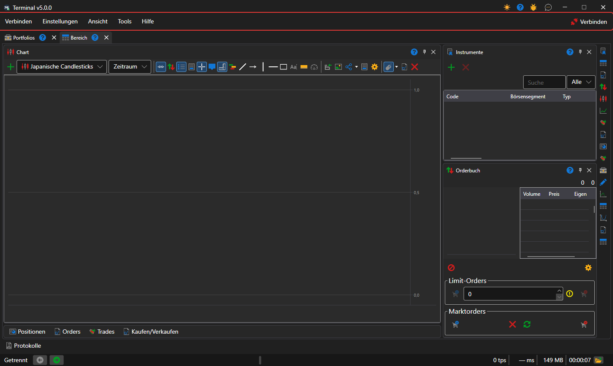

# Hauptmenü

Unter der Titelleiste des Fensters von [Terminal](../../terminal.md) befindet sich die Menüleiste: **Verbinden**, **Einstellungen**, **Ansicht**, **Tools** und **Hilfe**. Am Ende der Leiste steht die Schaltfläche **Verbinden**: Sie verbindet Terminal mit allen [eingerichteten Verbindungen](../connection_settings.md), und solange die Verbindung besteht, heißt sie **Trennen**. Solange Terminal verbunden ist, sind die Einstellungen der Verbindungen und des Emulators nicht verfügbar.

In der Titelleiste des Fensters, neben den Schaltflächen zum Minimieren und Schließen, befinden sich die Schaltflächen zum Wechseln des Designs, zur Hilfe, **Ein Problem melden** und **Kontaktieren Sie uns**.

## Menüeinträge

- **Verbinden** — Verbinden und Trennen, [Verbindungseinstellungen](../connection_settings.md) und die Einstellungen des Emulators, der Orders auf echten Marktdaten ausführt, ohne sie an den Handelsplatz zu senden.
- **Einstellungen** — die [allgemeinen Einstellungen](../settings/common_settings.md) des Programms; **Layout speichern...** und **Layout zurücksetzen**, das die Panels an ihre ursprünglichen Plätze zurückbringt; das [Zurücksetzen der Einstellungen](../settings/reset_settings.md); die Fenster **Instrumente und Verbindungen** und **Portfolios und Verbindungen**, in denen einem Instrument oder einem Portfolio die Verbindung zugewiesen wird, über die damit gehandelt wird.
- **Ansicht** — ein neuer [Arbeitsbereich](workspace.md) (**Bereich**) und das Umbenennen des aktuellen (**Umbenennen**); die Panels des gesamten Fensters: [Protokolle](logs.md), [Portfolios](portfolios.md), [Börsensegmenteditor](board_editor.md), **Marktdaten**, [Nachrichten](components/news.md), [Risiken](risk_management.md); das Wechseln des Designs.
- **Tools** — **Erstellung eines neuen Instruments**, **Neues Indexinstrument** aus mehreren Instrumenten und **Kontinuierliches Instrument** aus Futures mit verschiedenen Laufzeiten; das erstellte Instrument erscheint sofort in den [Instrumenten](components/instruments.md) des geöffneten Bereichs.
- **Hilfe** — **Dokumentation**, **Fehlerbericht**, Kontakt zum StockSharp-Team und das Fenster **Über das Programm**.

## Tastenkürzel

| Tasten | Aktion |
|---|---|
| **F5** | verbinden oder trennen |
| **Ctrl+,** | Verbindungseinstellungen |
| **Ctrl+S** | das Layout speichern |
| **Ctrl+T** | das Design wechseln |
| **F1** | die Hilfe öffnen |
| **Alt+C**, **Alt+S**, **Alt+V**, **Alt+T**, **Alt+H** | das Menü **Verbinden**, **Einstellungen**, **Ansicht**, **Tools**, **Hilfe** öffnen |
| **F9** | im aktiven Ticket [Kaufen/Verkaufen](components/buy_sell.md) zum Marktpreis kaufen |
| **F10** | im aktiven Ticket zum Marktpreis verkaufen |
| **Esc** | alle Orders des aktiven Tickets stornieren |

Das aktive Ticket ist das Ticket des Panels **Kaufen/Verkaufen** im gerade geöffneten Arbeitsbereich. Die Tasten **F9**, **F10** und **Esc** wirken nicht, solange der Cursor in einem Eingabefeld steht.

> [!WARNING]
> **F9** und **F10** senden echte Marktorders ohne Bestätigung an den Handelsplatz.

## Siehe auch

[Arbeitsbereich](workspace.md)

[Komponenten](components.md)
