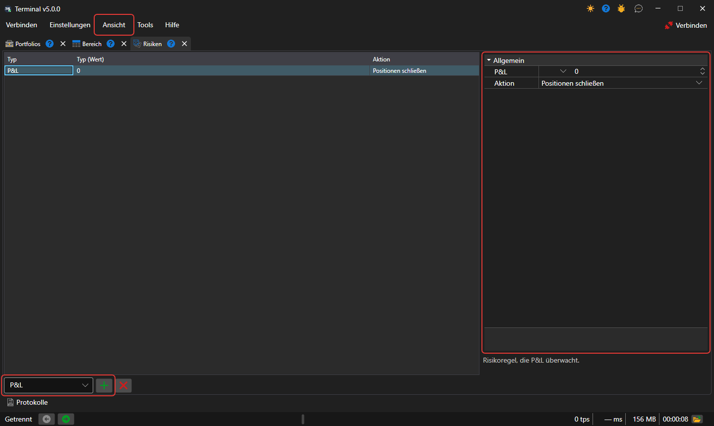

# Risikomanagement

Im Panel **Risiken** können Sie Einstellungen zur Risikokontrolle festlegen. Das Panel wird mit dem Eintrag **Ansicht → Risiken** des [Hauptmenüs](ribbon.md) geöffnet.

Um eine **Risikoregel** hinzuzufügen, wählen Sie ihren Typ in der Liste unter der Tabelle aus und klicken auf die Schaltfläche **Regel hinzufügen**. Die Regel erscheint in der Tabelle und rechts ihre Einstellungen: die Auslösebedingung der **Risikoregel** und die Aktion (Positionen schließen, Handel stoppen, Orders stornieren), die ausgeführt wird, wenn die Bedingung eintritt. Unter den Einstellungen wird die Beschreibung der ausgewählten Regel angezeigt. Die Schaltfläche **Regel löschen** löscht die markierten Regeln.

Die Regeln prüft die Verbindung des Terminals — an den Orders, Trades und Portfoliodaten, die über sie laufen. Die Menge der Regeln wird zwischen den Starts des Programms gespeichert.

Die Liste der Risikoregeln und ihre Beschreibung finden Sie im Abschnitt [Risikomanagement](../../designer/user_interface/risk_management.md).
