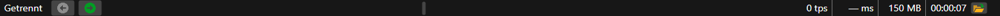

# Statusleiste

Unten im Fenster von [Terminal](../../terminal.md) befindet sich die Statusleiste. Von links nach rechts enthält sie:

- **den Zustand** — **Getrennt**, **Verbindet**, **Verbunden**, **Trennt** oder den Text des Verbindungsfehlers. Hierhin schreibt Terminal auch das Ergebnis der letzten Aktion, zum Beispiel „Layout gespeichert.“ oder „Instrument erstellt: …“;
- **die StockSharp-Nachrichten** — die Schlagzeilen der Nachrichten der Website, die mit den Pfeilschaltflächen durchgeblättert werden können;
- **die Zähler der Warnungen und Fehler** des Protokolls — sie erscheinen, wenn das Protokoll Warnungen oder Fehler enthält;
- **die letzte Protokollmeldung** — ein Rechtsklick darauf kopiert ihren Text in die Zwischenablage. Das gesamte Protokoll befindet sich im Panel [Protokolle](logs.md);
- **die Ticks pro Sekunde** (tps) — wie viele Markttrades (Ticks) Terminal in der letzten Sekunde empfangen hat;
- **die Verzögerung** (ms) — um wie viele Millisekunden der letzte Tick oder die letzte Änderung von Level 1 später als ihre Zeit am Handelsplatz eingetroffen ist;
- **der Speicher**, den die Daten von Terminal belegen, in Megabyte;
- **die Laufzeit** des Programms seit dem Start;
- die Schaltfläche **Logverzeichnis** — öffnet den Ordner, in den Terminal das Protokoll schreibt.

Solange Terminal nicht verbunden ist, werden Ticks und Verzögerung nicht gezählt: In der Leiste stehen **0 tps** und **— ms**.

## Siehe auch

[Protokolle](logs.md)

[Hauptmenü](ribbon.md)
