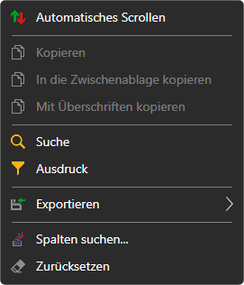
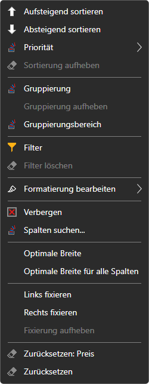

# Arbeiten mit Tabellen

Die Tabellen aller Panels von [Terminal](../../terminal.md) — Instrumente, Orders, Trades, Positionen, Portfolios, Level 1, Orderprotokoll, Nachrichten — funktionieren gleich.

## Menü der Tabelle

Ein Rechtsklick auf die Zeilen einer Tabelle öffnet ein Menü:

- **Automatisches Scrollen** — die Tabelle scrollt von selbst zu neuen Zeilen;
- **Kopieren**, **In die Zwischenablage kopieren** — kopieren die markierten Zeilen in die Zwischenablage: die sichtbaren Spalten in der Reihenfolge, in der sie angezeigt werden, durch Tabulatoren getrennt, eine Tabellenzeile pro Textzeile. **Mit Überschriften kopieren** fügt als erste Zeile die Namen der Spalten hinzu. Dasselbe wie **Kopieren** bewirkt **Ctrl+C**;
- **Suche** (**Ctrl+F**) — die Suche nach Text in der Tabelle. Es kann ausgewählt werden, in welchen Spalten gesucht wird; die Schaltflächen **Vorherige** und **Nächster** wechseln zwischen den gefundenen Zellen, **Leeren** setzt die Suche zurück;
- **Ausdruck** — ein Filter der Zeilen durch eine Bedingung an die Werte der Spalten in Form einer Formel, zum Beispiel `=[Price] > 100`. Das Feld schlägt die Namen der Spalten und Funktionen vor (`CONTAINS`, `STARTSWITH`, `ENDSWITH`, `TODAY`, `NOW` und andere), zeigt einen Fehler in der Formel sofort an, und **Vorschau** zeigt, was die Formel für die markierte Zeile ergibt. **Anwenden** schaltet den Filter ein, **Filter löschen** hebt ihn auf;
- **Exportieren** — die Tabelle in die Zwischenablage (als Text im CSV-Format oder als Bild), in eine CSV-, Excel- oder PNG-Datei. **Bildlink teilen** lädt ein Bild der Tabelle auf die StockSharp-Website hoch und kopiert den Link darauf; dafür ist eine Anmeldung auf der Website nötig. **Drucken** öffnet die Tabelle im Browser, aus dem heraus man sie drucken kann;
- **Spalten suchen...** — ein Fenster, in dem Spalten ein- und ausgeblendet werden;
- **Zurücksetzen** — der Tabelle ihr ursprüngliches Aussehen zurückgeben.

## Menü der Spalte

Ein Rechtsklick auf die Überschrift einer Spalte öffnet das Menü dieser Spalte:

- **Aufsteigend sortieren**, **Absteigend sortieren**, **Sortierung aufheben**. Ein Klick auf die Überschrift sortiert die Tabelle ebenfalls nach dieser Spalte. **Priorität** fügt die Sortierung nach der Spalte der bereits festgelegten hinzu, um nach mehreren Spalten gleichzeitig zu sortieren;
- **Gruppierung** — die Zeilen nach den Werten der Spalte gruppieren, **Gruppierung aufheben**. Der **Gruppierungsbereich** zeigt die Ebenen der Gruppierung: Eine Spalte kann aus der Liste hinzugefügt oder an ihrer Überschrift auf den Bereich gezogen werden, die Ebenen lassen sich umstellen, und jede Ebene hat ihre eigene Sortierrichtung;
- **Filter** — ein Filter der Zeilen nach den Werten dieser Spalte, **Filter löschen**;
- **Formatierung bearbeiten** — die Regeln, nach denen die Zellen der Spalte farbig hervorgehoben werden: **Regel hinzufügen**; eine Regel kann bearbeitet, ausgeschaltet oder gelöscht werden;
- **Verbergen** — die Spalte entfernen, **Spalten suchen...** — sie zurückholen;
- **Optimale Breite** der Spalte und **Optimale Breite für alle Spalten** — die Breite nach dem Inhalt;
- **Links fixieren**, **Rechts fixieren**, **Fixierung aufheben** — eine fixierte Spalte bleibt beim seitlichen Scrollen der Tabelle an ihrem Platz;
- **Zurücksetzen** der Spalte oder der ganzen Tabelle.

Das Aussehen der Tabelle — welche Spalten angezeigt werden, ihre Reihenfolge und Breite — wird zusammen mit der Anordnung des Fensters gespeichert.

## Siehe auch

[Arbeitsbereich](workspace.md)

[Komponenten](components.md)
