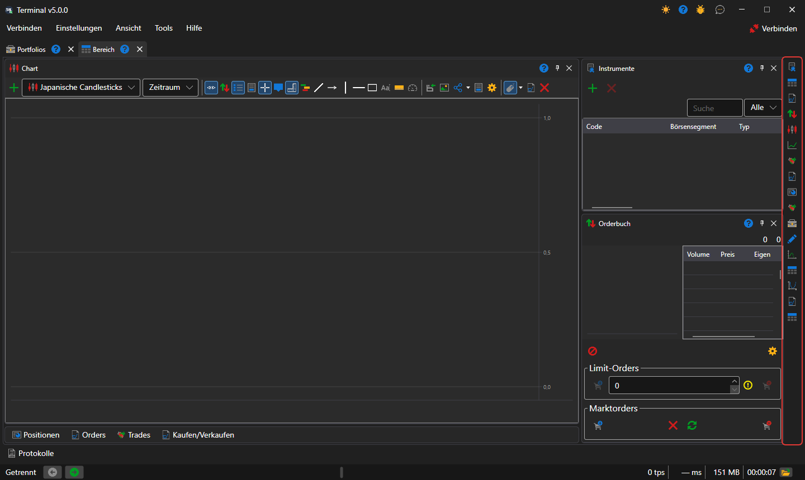
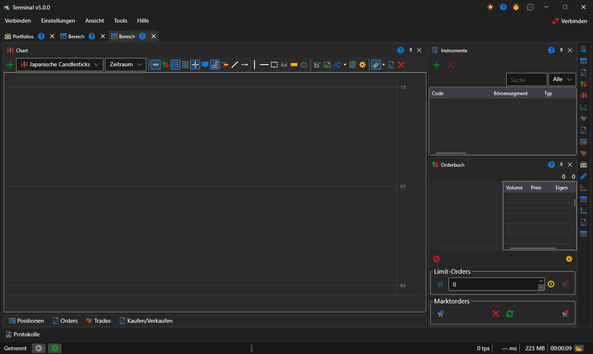

# Arbeitsbereich

Ein Arbeitsbereich ist eine Registerkarte des Fensters von [Terminal](../../terminal.md) mit einem eigenen Satz von Panels: Charts, Tabellen, Tickets. Es kann beliebig viele Bereiche geben, und jeder lebt sein eigenes Leben: Ein in einem Bereich ausgewähltes Instrument ändert die Panels eines anderen nicht.

Ein neuer Bereich wird mit dem Eintrag **Ansicht → Bereich** des [Hauptmenüs](ribbon.md) angelegt, der aktuelle wird mit dem Eintrag **Ansicht → Umbenennen** umbenannt.

## Panels des Bereichs

Panels werden mit den Schaltflächen der senkrechten Leiste am rechten Rand des Bereichs hinzugefügt — eine Schaltfläche pro [Komponente](components.md). Jeder Klick öffnet ein weiteres Panel dieser Art, sodass ein Bereich zum Beispiel zwei Charts für verschiedene Instrumente haben kann. Ein Panel kann an seiner Überschrift an eine andere Stelle des Bereichs gezogen, an den Rand eines benachbarten Panels angedockt, mit ihm zu Registerkarten zusammengelegt oder in ein eigenes Fenster verschoben werden.

## Anordnung eines neuen Bereichs

Ein neuer Bereich ist so angeordnet, wie es in Handelsterminals üblich ist: das Chart in der Mitte über die ganze Höhe, rechts die [Instrumente](components/instruments.md) über dem [Orderbuch](components/order_book.md), und die Tabellen **Positionen**, **Aufträge**, **Eigene Trades** und das Ticket **Kaufen/Verkaufen** sind zu einer Reihe von Registerkarten unter dem Chart eingeklappt. Ein Klick auf eine Registerkarte klappt die Tabellen auf, die Schaltfläche in ihrer Überschrift klappt sie wieder ein. Ob die Tabellen eingeklappt sind, merkt sich Terminal zusammen mit der Anordnung der Panels.

Die Anordnung der Panels speichert Terminal bei jeder Änderung selbst; **Einstellungen → Layout speichern...** (Ctrl+S) speichert sie sofort, und **Einstellungen → Layout zurücksetzen** bringt die Panels an ihre ursprünglichen Plätze zurück.

## Siehe auch

[Hauptmenü](ribbon.md)

[Komponenten](components.md)
