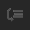

# Debugging

In the process of strategy testing, it often becomes necessary to check what data enters the input of a given cube or is passed at its output. To do that, the [Designer](../../designer.md) features the **Debugger**.

The debugger buttons are located on the toolbar of the scheme itself, above the canvas. Most of them have keys: **F9** — add a breakpoint, **F10** — go to the next element, **F11** — step into the composite element, **Shift+F11** — step out of the composite element. A right-click on a socket sets and removes a breakpoint on that socket, and the **Start** (**F5**) button on the **Backtest** tab continues testing up to the next breakpoint.

The debugger buttons:

- **Add breakpoint** – to add a breakpoint at the selected element. Elements, for which a breakpoint is added, are highlighted with a red border.
- **Delete breakpoint** – to delete a breakpoint.
- **Next element** – when the breakpoint is triggered, moves to the next element of the scheme.
- **Step to out** – when the breakpoint is triggered, moves to the output of the current element, is used to check the values, passed at the element output.
- **Step in** – when the breakpoint is triggered, moves inside the composite element. Automatically opens the composite element scheme and stops at the element to which the data is first transmitted.
- **Step out** – when the breakpoint is triggered and is within the composite element, it exits one level up where an open composite element is used.
- **Continue** – Continues until the next breakpoint is triggered. This is the **Start** button of the **Backtest** tab: while the test is running, it is named **Cont-ue**.

## Recommended content

[Break points](debugging/break_points.md)
