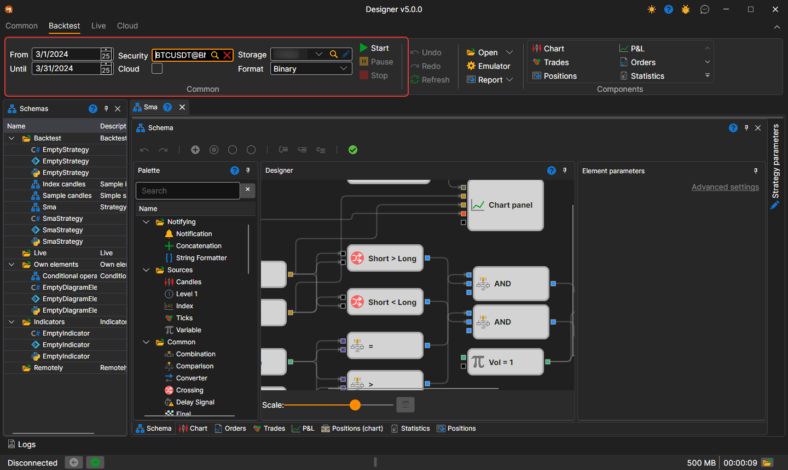
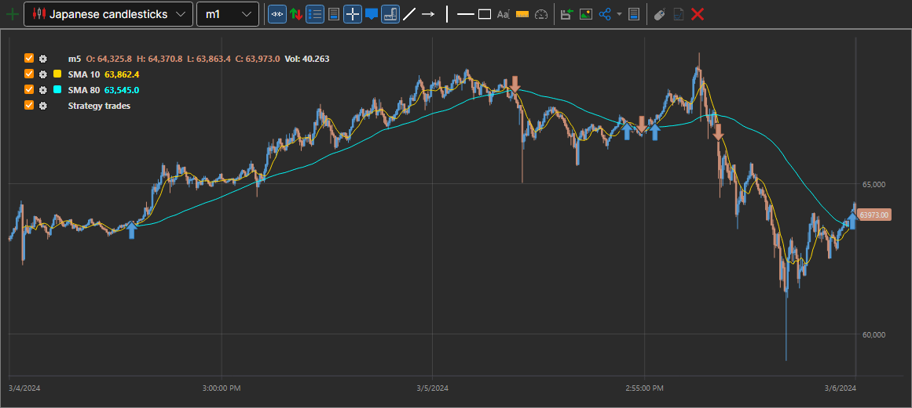
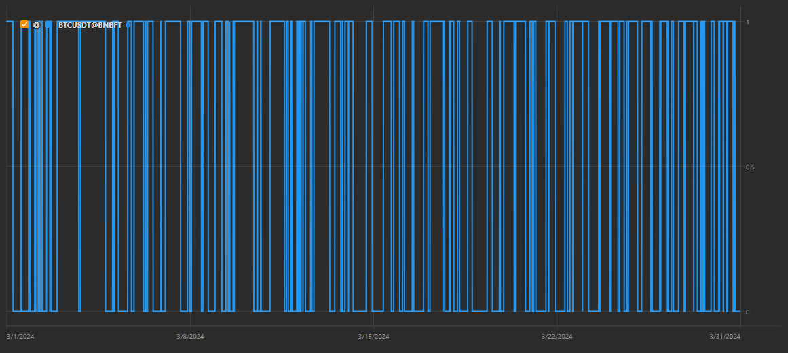
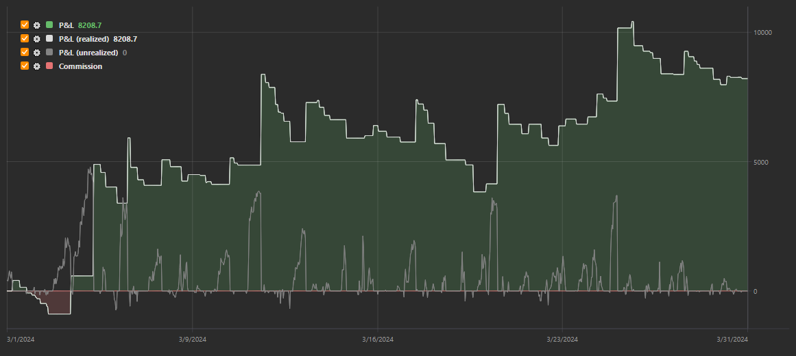

# Getting started

For instance, the SMA strategy example will be considered.

To run the test on the history, you shall select a strategy, the scheme of which will be tested on the history. The strategy is selected on the [Schemas](../user_interface/schemas.md) panel in the strategy folder, by double clicking on the strategy of interest.

Before testing, load market data (instruments, candles, tick trades and\/or order books). This is described in [Market data storage](../market_data_storage.md).

When switching to the tab with a strategy, the **Backtest** tab automatically opens in the **Ribbon**. Set the testing period on this tab (**From** and **To**), select the instrument in the **Security** field, and in the **Storage** and **Format** fields select the market data storage ([Market data storage](../market_data_storage.md)) and the format it is written in.

The following parameters are used in the example with the SMA strategy:

1. BTCUSDT@BNBFT instrument
2. Period from March 1, 2024 to March 31, 2024
3. A storage into which the candles of this instrument for this period have been downloaded
4. Storage format - **Binary**

The strategy itself builds two moving averages — **SMA 10** and **SMA 80** — on five-minute candles and trades the volume set by the **Vol = 1** cube in the scheme.

After setting up all the required parameters, start up the strategy testing by clicking the  button.

During or after the testing you can view charts and tables with the testing information.

The graph shows that the trades take place at the intersection of moving averages, as planned by the strategy.

The **Positions (chart)** chart shows that the strategy position moves between 0 and 1: the strategy buys when the short average crosses the long one from below upwards, and closes the position on the opposite crossing.

The **P&L** chart shows how the profit and loss of the strategy changed over the test, as well as the commission.

## Recommended content

[Live execution](../live_execution/getting_started.md)
