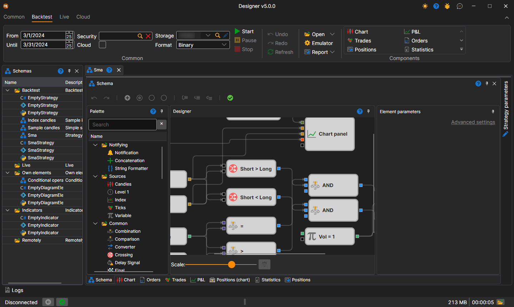
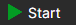
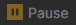
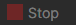
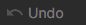

# User interface

To run the test on the history, you shall select a strategy, the scheme of which will be tested on the history. The strategy is selected on the [Schemas](../user_interface/schemas.md) panel in the strategy folder, by double clicking on the strategy of interest. When you select a strategy for the workspace, a new tab with a strategy appears, when you switch to this tab, the **Backtest** tab will automatically open in the Ribbon.

The **Common** group of the **Backtest** tab sets the testing period (**From** and **To**), the **Security**, the market data storage (**Storage**) and the format it is written in (**Format**). The **Cloud** checkbox runs the testing in the StockSharp cloud instead of on this computer.

The strategy for testing is started by clicking the **Start** button . After starting the strategy for testing, the **Pause**  button, suspending the testing, and the **Stop**  button, completely stopping the testing, become active. When editing the strategy, the buttons **Undo** (Ctrl+Z) , canceling the last action, **Redo** (Ctrl+Y) , returning what was undone, and **Refresh** (Ctrl+R) , completely updating the scheme, are useful.

The other buttons of the tab:

- **Open** — open the same strategy for [optimization](../optimization/brute_force.md) or for [trading](../live_execution/getting_started.md);
- **Emulator** — [emulation settings](../user_interface/components/backtesting_settings.md);
- **Report** — a report on the completed test in Excel, JSON, XML or CSV format;
- the **Components** group — components that can be added to the strategy tab: chart, P&L, trades and others.

The [Debugger](debugging.md) — breakpoints and step-by-step execution — is located on the **Scheme** panel.

The selected strategy tab contains the following panels by default:

- The **Scheme** panel, in which the main working process on the strategy and its components design is performed, by combining cubes and connecting lines. The Scheme is described in detail in the [Diagram panel](../strategies/using_visual_designer/diagram_panel.md) section.
- Panels of information components — **Chart**, **Orders**, **Trades**, **P&L**, **Positions (chart)**, **Statistics**, **Positions** — as tabs under the scheme.
- The **Strategy parameters** panel, collapsed by default at the right edge of the strategy tab: the scheme parameters that can be changed before the start.

## Recommended content

[Backtesting settings](../user_interface/components/backtesting_settings.md)
