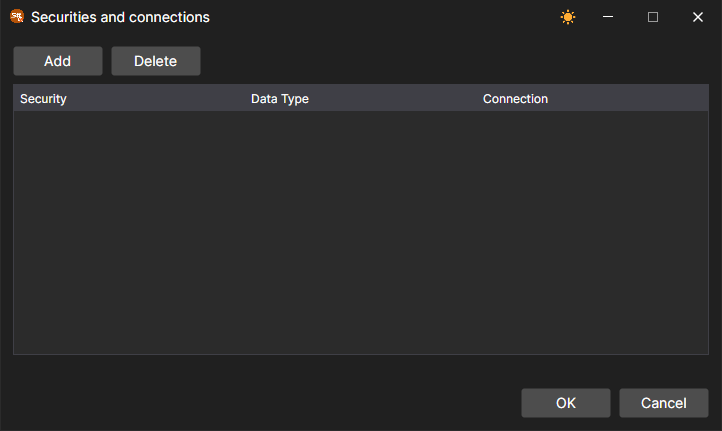

# Symbol mapping

The same instrument in different trading systems can be called differently, and its data and orders can go through different connections. For this, [Designer](../../designer.md) has three windows.

## Codes mapping

The **Codes mapping** button on the market data panel opens the **Security codes <\-> Adapters codes** window. The list above the table selects a connection, the  button adds a row, and the delete button removes the selected one. The **Security code** and **Board Code** columns specify the instrument as it is named in **Designer**, and the **Adapter code** and **Adapter board code** columns specify how the selected connection names it.

## Securities and connections

The **Securities and connections** item of the drop-down list of the **Connect** button on the **Common** tab opens a window in which, for an instrument and a data type, you select the connection through which this data is received. The **Add** button adds a row in which the **Security**, **Data Type** and **Connection** columns are filled in; the **Delete** button removes the selected row.

## Portfolios and connections

The **Portfolios and connections** item of the same list opens the same kind of window for portfolios: the **Portfolio** column specifies the portfolio, and the **Connection** column specifies the connection through which orders for it are sent.

In [Terminal](../../terminal.md), both windows are opened from the **Settings** menu of the [main menu](../../terminal/user_interface/ribbon.md).
