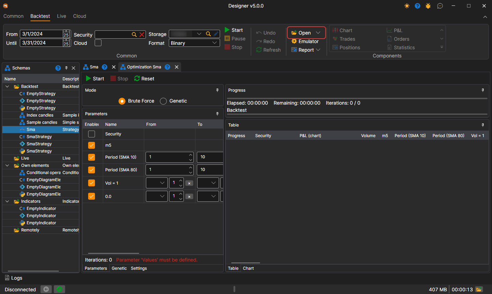
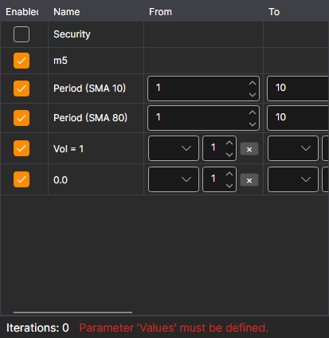
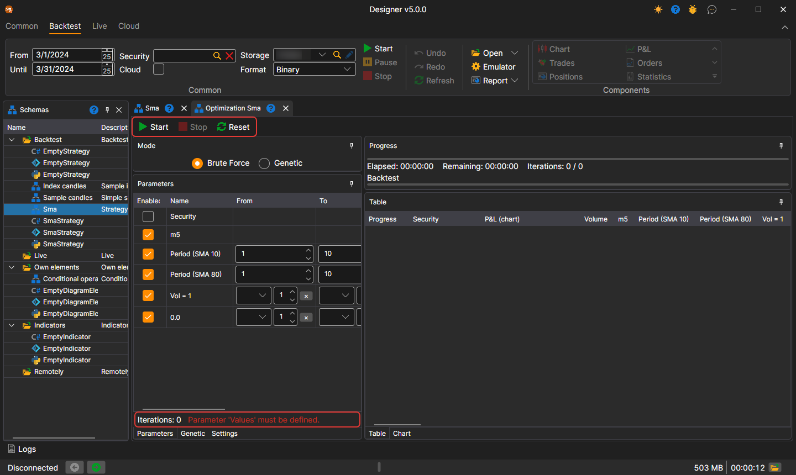

# Brute-force

To switch to strategy optimization mode, on the **Backtest** tab open the **Open** drop-down list and select **Optimization**. The optimization example will be considered using the SMA strategy created [from cubes](../strategies/using_visual_designer/first_strategy.md).

A tab named Optimization + 'Strategy Name' will open in the workspace. The **Optimization** tab is divided into two areas: on the left — what and how to optimize, on the right — the optimization result:

- At the top left is **Mode**: **Brute Force** or **Genetic**. Below it are the tabs: **Parameters** — the strategy parameters, which are [iterated over](optimization_parameters.md); **Genetic** — settings for [genetics](genetic.md); **Settings** — settings of the emulation and of the optimizer itself, for example how many runs to execute simultaneously (**Parallel**) and how many iterations are allowed (**Iterations**).
- On the right is **Progress**: how much time has elapsed, approximately how much is left, and how many iterations have been completed out of those planned. Below it are the **Table** tab, each row of which is the result of testing the strategy with unique parameters, and the **Chart** tab for displaying the results in the form of a [3D chart](3d_chart.md).

Setting the parameters for iteration results in more than 1000 iterations. After starting the optimizer, the progress at the top above the results will show data on the planned number of iterations, how many have already been completed, and how much time is approximately needed until completion:

## Parameter table and panel buttons

In the parameter table, each row shows how many values it gives with the specified **From**, **To** and **Step** (the **Count** column) and what is wrong in the row (the **Error** column) — for example, a step at which the iteration does not reach the upper bound. Below the table is the number of runs the iteration of all parameters together gives, and the first error, if there is one.

The **Start**, **Stop** and **Reset** buttons are located right on the optimizer panel, and below them is the progress bar of the current run. The results table has a **Security** column: the instrument the run was made on.

## See also

[Example of backtesting](../backtesting/getting_started.md)
