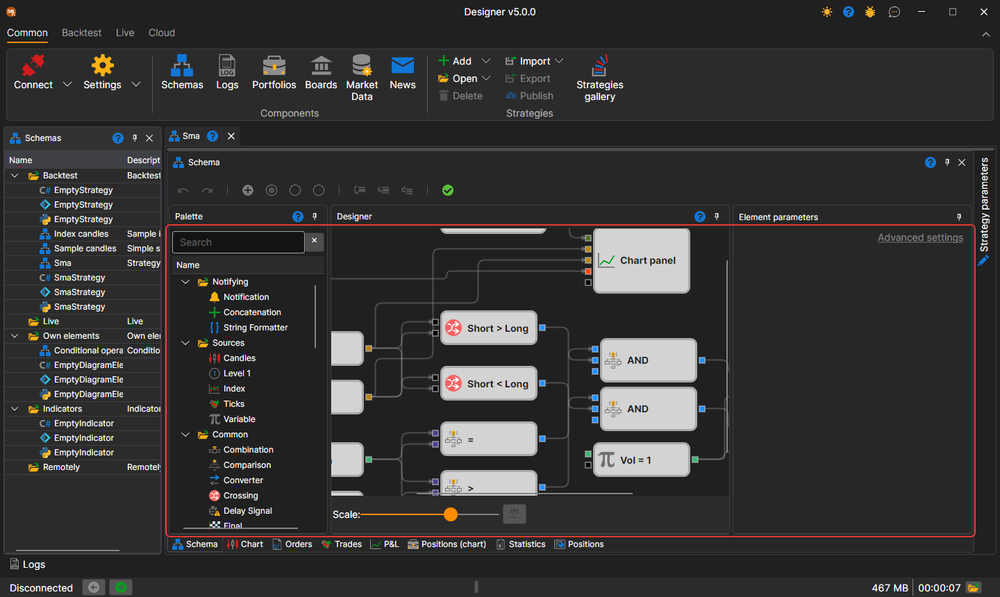
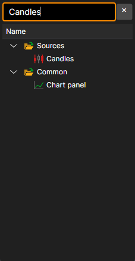
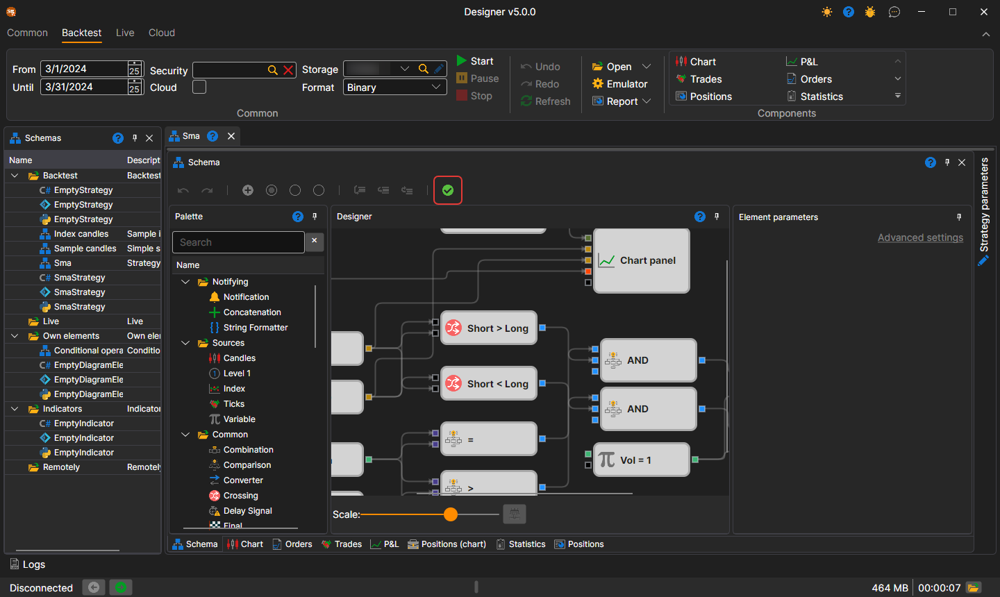
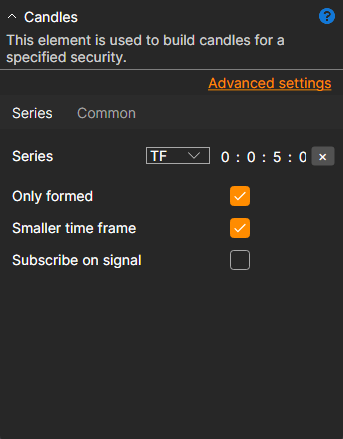
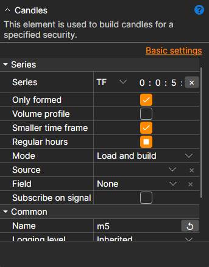

# Strategy Designer

The main process of designing a strategy and its component elements takes place in the **Scheme** panel by combining blocks and connecting lines. The Scheme panel consists of the panels: **Palette**, **Designer**, and **Element parameters**.

## Palette Panel

The **Palette** panel contains blocks from which strategies are created. All elements in the palette are divided into categories, described in the section [Description of blocks](elements.md). To add a block to the **Designer** panel, left-click on the required block and, without releasing the button, drag it to the **Designer** panel. Double-clicking a block puts it in the center of the **Designer** panel. After that, the element will be automatically selected, and its parameters will be shown in the window for editing the block's properties.

The search line above the palette finds a block by its name, by its description and by the name of its category. The **Enter** key puts the selected block on the **Designer** panel, or the first one found if nothing is selected.

## Designer Panel

The **Designer** panel is where the entire process of creating a strategy occurs through the combination of blocks and connections (lines). It visually represents the strategy scheme. Detailed information about creating a strategy is described in the section [Creating an algorithm from blocks](first_strategy.md).

The selected blocks are moved with the arrow keys: by one step, and by ten with **Shift** held down. While a connecting line is being dragged, only the sockets it can be connected to are highlighted, and the end of the line snaps to the nearest of them by itself.

The scale of the scheme is changed with the **Scale** slider under the panel or with the mouse wheel while holding **Ctrl**. Keys of the **Designer** panel:

| Keys | Action |
|---|---|
| **Ctrl+Z**, **Ctrl+Y** | undo and redo an action |
| **Ctrl+C**, **Ctrl+X**, **Ctrl+V** | copy, cut and paste the selected blocks |
| **Ctrl+A** | select all blocks |
| **Delete** | delete the selection |
| **Esc** | clear the selection or cancel dragging a line |
| **Ctrl+Plus**, **Ctrl+Minus** | zoom in and zoom out |
| **Ctrl+0** | restore the original scale |
| **Ctrl+1** | fit the whole scheme into the panel |
| **Alt+Z** | fit the scheme into the panel or return to the previous scale |

The button with a check mark on the scheme toolbar, whose tooltip is **Validate the diagram by generating and compiling its code**, checks the scheme without starting the strategy. If the scheme has an error, its text is shown in red over the **Designer** panel; debugger errors are shown there as well.

## Element Parameters Panel

The **Element parameters** panel displays the parameters of the selected block on the **Designer** panel. The selected block is highlighted with a frame.

The **Element parameters** panel can be displayed in two modes: *Basic settings* and *Advanced settings*.

By default, when building a scheme, the properties are initially displayed in *basic settings* mode. To switch to *advanced settings* mode, you need to click on the corresponding title.

In *basic settings* mode, only the most necessary properties of the block are displayed. For example, for the [candles](elements/data_sources/candles.md) block, the timeframe, the flag for receiving only formed candles, the flag for the possibility of constructing candles from a smaller timeframe, and the flag for subscribing to candles on signal will be displayed.

In *advanced settings* mode, all properties of the block available for change and setting will be displayed.

All blocks contain a set of predefined properties, which become visible in *advanced settings* mode:

- **Name** – the name of the element, displayed in the designer.
- **Logging level** – the logging level for this element.
- **Parameters** – display the element's parameters in higher-level elements.
- **Sockets** – display the element's sockets in higher-level elements.

Detailed information about the properties of each block is described in the section [Description of blocks](elements.md).

## See Also

[Description of blocks](elements.md)
