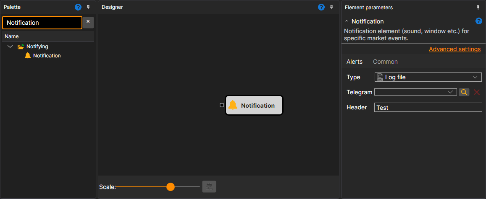

# Notification

The cube sends a notification when data arrives on its input socket. The incoming value is converted to text via `ToString`. You can connect a [Variable](../data_sources/variable.md) to send fixed text, attach trade or candle streams to see their details, or use [String format](string_format.md) and [String concat](string_concat.md) cubes to prepare a custom message.

### Incoming sockets

Incoming sockets

- **Message** - data to send. Any value is accepted and converted to a string.

### Parameters

Parameters

- **Type** - how to send the message: by sound, by a pop-up window, to a log file or to Telegram. The methods are described in the [Notifications](../../../../../terminal/notifications.md) section.
- **Telegram** - channel used for Telegram notifications.
- **Header** - the header of the message.

## Recommended content

[String format](string_format.md)
[String concat](string_concat.md)
[Notifications](../../../../../terminal/notifications.md)
