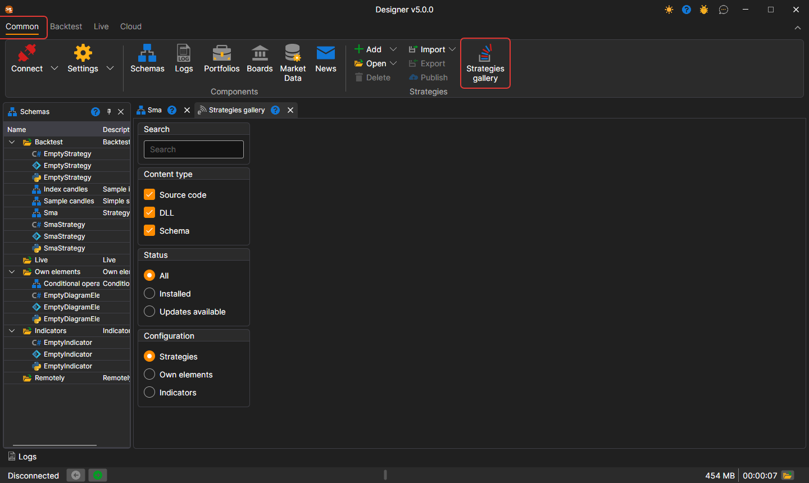

# Strategy Gallery

The **Strategy Gallery** provides the opportunity to download ready-made trading strategies to your computer. You can open the **Strategy Gallery** by clicking on the **Strategy Gallery** button in the **Common** tab.

Strategy cards appear as the catalog is read from the website, and while it is being read, the panel shows the **Loading gallery strategies...** label. If the catalog cannot be read, the panel shows the reason and the **Refresh** button, which repeats the loading.

To download a strategy to your computer, you need to:

- select the strategy of interest and click the Download button:

  

- the strategy will be added to the strategy tree in the **Backtest** section:

  

## See Also

[Publishing Your Strategy](strategy_gallery/publish_own_strategy.md)