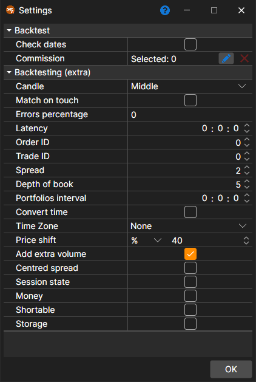

# Backtesting settings

The emulation settings are opened with the **Emulator** button on the **Backtest** tab of the Ribbon when a strategy is open for backtesting or for optimization. When you select a property, its detailed description appears at the bottom of the window. The properties are grouped:

**Backtest**

- **Check dates** – to check whether the loaded days are trading days.
- **[Commission](../commissions.md)** – the commission (brokerage, exchange, etc.).

**Backtesting (extra)**

- **Candle** – at which candle price orders are executed when the test runs on candles: middle, open, high, low or close.
- **Combine on touch** – during emulation, combine orders when the trade price touches the order price (i.e., equal to the order price).
- **Errors percentage** – the percentage value of the error in registering new orders. The value can be from 0 (there will be no errors) to 100.
- **Latency** – the minimum value of the registered order latency.
- **Order ID** – the number from which the emulator will generate identifiers for orders.
- **Trade ID** – the number from which the emulator will generate identifiers for trades.
- **Spread** – the spread size in the price steps. It is used in specifying the spread for the generation of an order book from tick trades.
- **Depth of book** – the maximum depth of the order book that will be generated from the ticks.
- **Portfolios interval** – the interval for portfolio recalculation. If the interval is zero, no recalculation is performed.
- **Change time** – to change time for orders and trades into exchange time.
- **Time Zone** – the time zone of the exchange.
- **Price shift** – the price shift from the last trade, specifying the limits of the maximum and minimum prices for the next session.
- **Add extra volume** – add extra volume to the order book when orders with large volume are being registered.
- **Centred spread** – to split the spread equally around prices for which it is unknown which side traded (for example, prices from candles), so that a buy and a sell pay the same half of the spread.
- **Session state** – to check the trading state.
- **Money** – to check the cash balance.
- **Shortable** – whether short positions can be opened.
- **Storage** – to allow saving the messages that the emulator creates.

The testing period, the instrument, the market data storage and its format are set on the **Backtest** tab itself ([User interface](../../backtesting/user_interface.md)), and the scheme parameters are set on the **Strategy parameters** panel at the right edge of the strategy tab.

## Recommended content

[Chart](chart.md)
