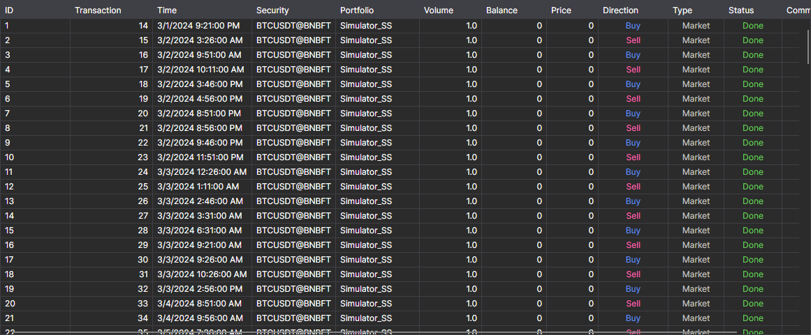

# Orders

The **Orders** component is a table with orders, which displays complete information about all the orders of the strategy. 

The list above the table selects which orders to show: **All**, only active ones (**Active**), executed ones (**Done**) or rejected ones (**Failed**).

How to copy table rows, search and filter them, and configure columns is described in the [Working with tables](../../../terminal/user_interface/tables.md) section.

## Recommended content

[Trades](trades.md)
