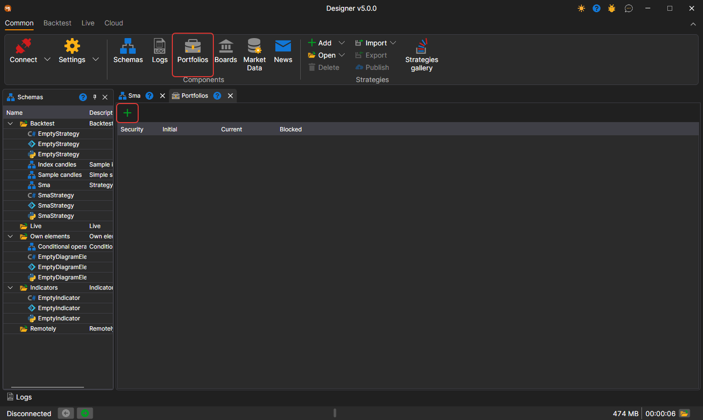
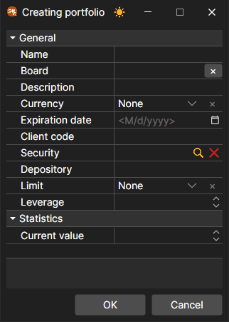

# Portfolios

To work with portfolios there is the **Portfolios** panel. You can open it by clicking the Portfolios button in the **Common** tab.

The **Portfolios** panel is a table that shows the basic data on the portfolio, and the current positions for these portfolios. By double-clicking on the portfolio or position, the **Creating portfolio** window or the **Creating position** window appears in which you can edit the selected portfolio or position. To create a new portfolio or a new position, you should click the  button and select the appropriate item in the drop-down menu.

A right-click on a row opens a menu with the **Edit**, **Close position**, **Reverse position**, **Withdraw** and **Hide zero balances** items; they are described on the Terminal [Portfolios](../../terminal/user_interface/portfolios.md) page.

## Recommended content

[Strategy gallery](../strategy_gallery.md)
