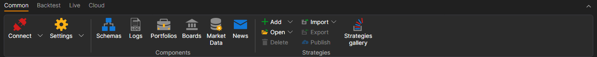
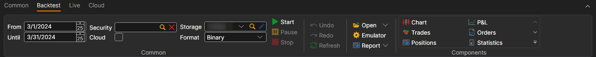
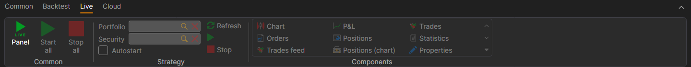
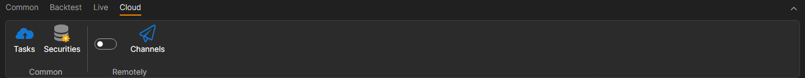

# Ribbon

The main user interface element of [Designer](../../designer.md) is the **Ribbon**, which runs along the top of the application window. The ribbon allows for quick access to necessary commands. Commands are organized into logical groups, collected on tabs. To navigate to the desired tab, simply click on its title (name). Each tab is associated with the type of action being performed.

1. The **Common** tab, which opens by default after starting, contains elements that may be needed at the initial stage of work. From the **Common** tab, you can open [Connection Settings](../connections_settings.md), [Scheme Panel](schemas.md), [Logs Panel](logs.md), [Portfolios](portfolios.md), [Board Editor](boards.md), [Creating a Repository of Historical Data](../market_data_storage/getting_started.md). Also, on the **Common** tab, you can add, open, delete, import, and export strategies. If you want to share your strategy with the community, you can do so by clicking the *Publish* button. The adjacent button - *Available Strategies*, opens algorithms published by you and other users. On the right, there are service buttons for calling help, as well as for contacting us. You can report a problem or write to us in Telegram chat.

2. The **Backtest** tab automatically opens when selecting a strategy on the [Scheme](schemas.md) panel. The **Backtest** tab contains the main elements for creating, debugging, testing, and optimizing strategies ([Creating a Strategy](../strategies/using_visual_designer.md), [Example of Backtesting](../backtesting/getting_started.md)). Also, on this tab, the strategy is launched for real trading, and necessary components for your strategy are selected: chart, order book, trades, etc.

3. The **Live** tab is intended specifically for real trading. Details on connection settings are written in [Connection Settings](../connections_settings.md). Real trading using [Designer](../../designer.md) is described in [Live Trading](../live_execution/getting_started.md).

4. The **Cloud** tab. [Designer](../../designer.md) is designed to work with cloud services. The **Tasks** button shows completed *Cloud Tasks*, and the **Securities** button shows the instruments available in the Cloud. In the **Remotely** group, a switch enables remote control of strategies via the Telegram bot ([Control Panel](../../telegram_services/control_panel.md)), and the **Channels** button opens the list of Telegram channels to which Designer sends messages. Remote control cannot be enabled in offline mode, and while the profile is not activated in the Telegram bot, Designer offers to go to the bot and opens its page.

On macOS, the main [Designer](../../designer.md) commands are duplicated in the system menu bar: creating and opening strategies, panels, connection, settings, build, debugging, and help with the **About** window.

## See Also

[Workspace](workspace.md)
