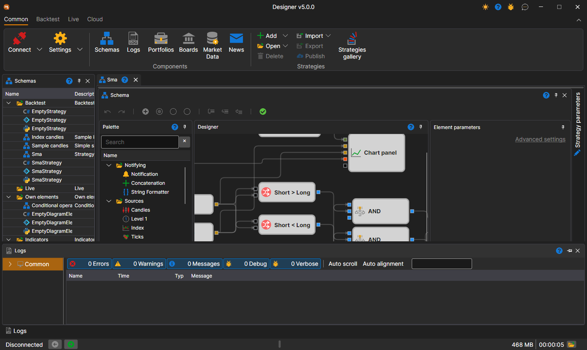

# Workspace

The **Workspace** in [Designer](../../designer.md) is a windowed interface with panel docking similar to that used in Microsoft Visual Studio. By clicking the header of the panel with the left mouse button and holding it, you can lock the panel in a convenient place. By dragging the edges of the panel, you can adjust its height or width:

At the bottom of the window is the status bar: whether [Designer](../../designer.md) is connected (**Disconnected**, **Connected** or the connection error text), StockSharp news, counters of log warnings and errors, the last log message (clicking it opens the [Logs Panel](logs.md)), used memory, uptime and the log folder button. These parts are described in more detail in the Terminal [Status bar](../../terminal/user_interface/status_bar.md) section.

## Recommended content

[Schemas](schemas.md)
