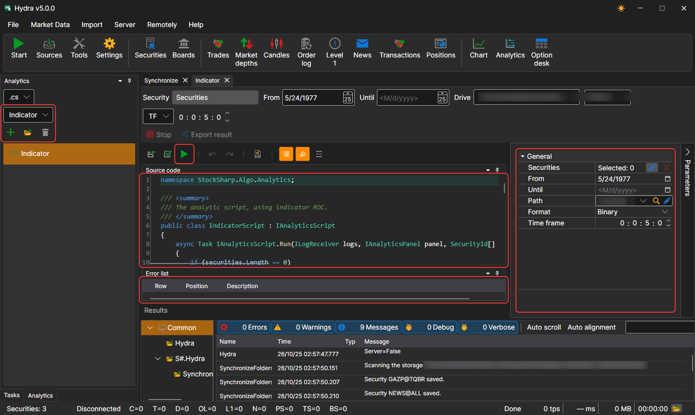
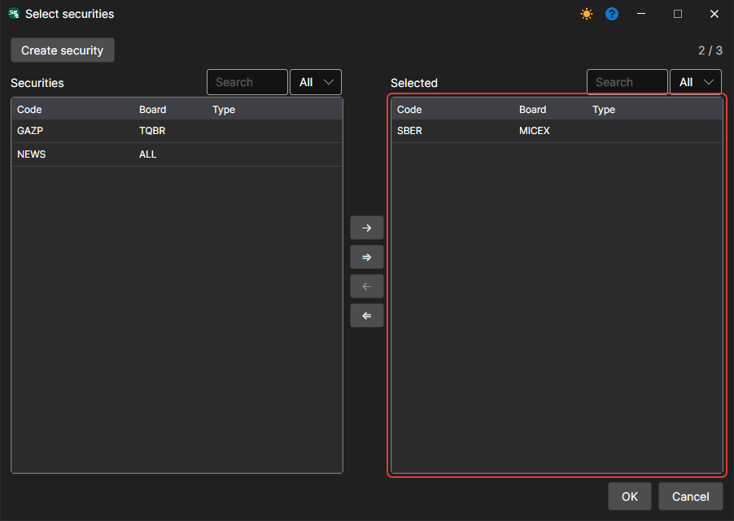

# Running a Script

To create a new analytics script, open the **Analytics** tab on the left panel, select the script language and a template for a quick start, and click **Add**. The script opens in a separate tab:

The screenshot presents the main interface of this feature, consisting of several key components:

- **Analytics panel**: on the left, the language and template of a new script are selected (intraday volume, volume profile, charts, indicators and other analysis tools); below them are the icon buttons **Add**, **Open** and **Delete** (the button name is shown in its tooltip) and the list of created scripts.
- **Launch parameters and buttons**: above the code, the instruments, period, storage, format and time frame are set, and the buttons perform **Save source**, **References** (the assemblies and packages the script references), **Compile and run source**, **Stop** and **Export result**.
- **Code Window**: The code window displays the source code of the selected analytical script. Users can directly edit the code to customize or create analytical calculations and strategies.
- **Parameter Panel**: on the right side, opened with the **Parameters** button; it sets parameters for analytical scripts, including the selection of instruments, analysis period, data path, and other settings.
- **Error List**: At the bottom of the interface, there is a list of errors detected during the compilation or execution of the analytical script.

The analytics script is formatted as a class inherited from [IAnalyticsScript](xref:StockSharp.Algo.Analytics.IAnalyticsScript).

When setting parameters:

- **Instrument** can be set from one to several instruments depending on the script's logic.

- The date range.
- The storage from which to retrieve data.
- The script's working time frame, if it uses one.

Clicking the  button compiles and runs the script, and the results of its execution open in a new tab.
