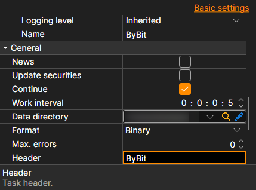

# Common connection settings

Connection properties common to all sources.

**General**

The settings specific to each source come first: keys, addresses, reconnection. They are followed by the settings common to all sources:

- **News** - download news.
- **Update securities** - update securities when connected.
- **Continue** - continue downloading from the last downloaded date.
- **Work interval** - operation interval.
- **Data directory** - the directory with data where the final files in StockSharp format will be saved.
- **Format** - data format: BIN\/CSV.
- **Max. errors** - the maximum number of errors after which the task will be stopped. The default is 0, which means ignoring the number of errors.
- **Header** - title of the task.
- **Working time** - the work schedule of the task.
- **Validation** - what to do with data that has not passed validation: nothing, delete it or stop the subscription.

**Remotely**

- **Enabled** - control the task remotely.
- **Notification** - the channel to which notifications about the task arrive.
- **Logging level** - which task messages to send to the channel.
