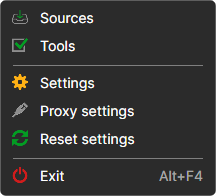
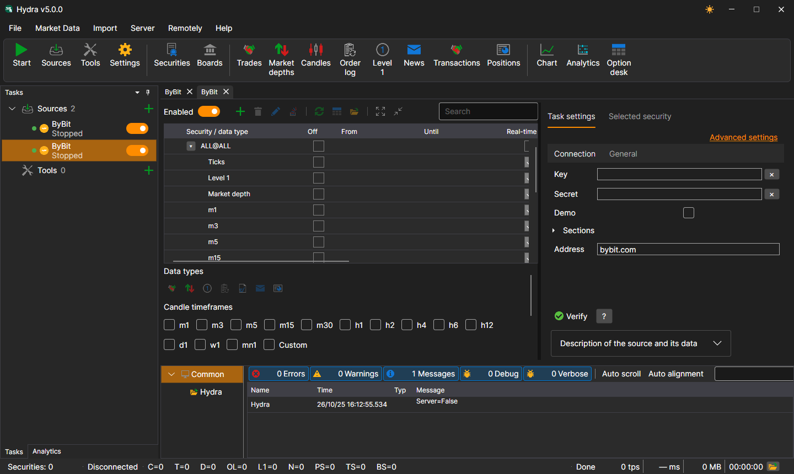
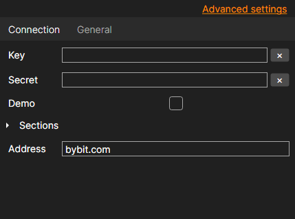

# Select source

To add a new market data source, open the **File** menu and select **Sources**, or click the **Sources** button on the toolbar.

A list of sources opens. You can select several at once, by clicking the check box or the name, and click **Add selected**.

You can also add several instances of the same source, for example, two **ByBit** sources with different keys or different folders for downloaded data. Each instance is a separate task on the **Tasks** panel. The **Header** on the **General** tab of the source settings helps to tell them apart.

In order for the source to download data after clicking the **Start** button, it should be enabled. This is done with the  switch: every source has it on the **Tasks** panel and above the source instruments table (**Enabled**). The source can be enabled before or after adding instruments.

An unnecessary source is deleted with the **Delete** command in the context menu of the source on the **Tasks** panel.

The source settings are on the **Task settings** tab to the right of the instruments table. The **Connection** tab has what the source cannot connect without: keys, address and so on; the **General** tab has the rest. The **Advanced settings** link shows all the parameters of the source, not only the basic ones.

Common settings for all sources can be found in the [Common connection settings](common_connection_settings.md) item.

Each connection has its own characteristics. The link [List of connectors](../data_sources.md) provides a list of connectors and their settings.

**Watch [video tutorial](../videos/sources_samples.md)**
