# First start

At the first start, Hydra offers to select data sources. Later, the same window is opened with the **Sources** button on the toolbar or from the **File** menu.

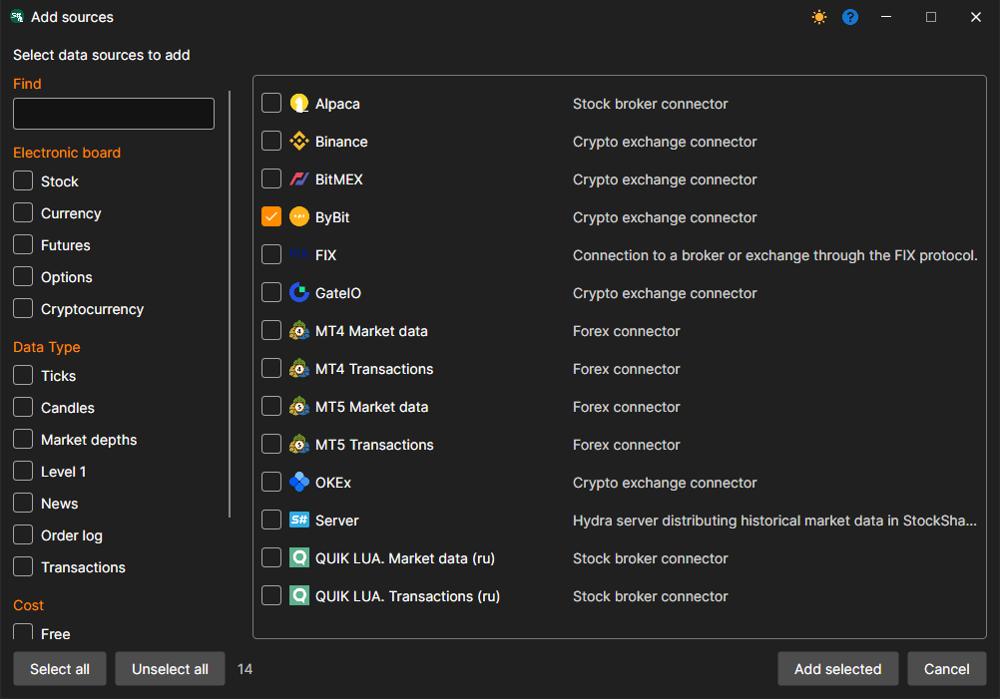

Mark the required sources — you can click both the check box and the name. The filters on the left narrow the list: board, data type, price; the **Find** field searches by name. For example, mark **ByBit** and click **Add selected**.

Next, the same kind of window opens with utilities — tasks that do not download data but work with data already downloaded: scheduled import and export, conversion, backup to the cloud. For more details, see the [Utilities](tasks.md) section. If you do not need utilities yet, click **Cancel**.

For each added source, Hydra asks whether to enable it now. An enabled source downloads data when the **Start** button is pressed; a disabled one is skipped. Answer **Yes**.

The source appears on the **Tasks** panel on the left, and its panel opens in the center: the instruments table, below it the settings of the received data, and on the right the connection settings.

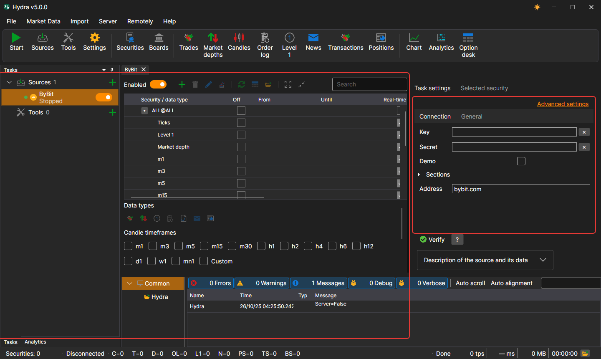

## Instruments

> [!TIP]
> Data is downloaded only for the instruments added to the source.

Right after the source is added, it has only the service instrument **ALL@ALL** — "all instruments of the source". It is used to download the data that the source can provide for all its instruments at once. For example, let's add the BTCUSDT spot pair.

1. Click the **Add securities**  button above the instruments table. A selection window opens: on the left are the instruments Hydra knows, on the right are the ones selected for the source.

   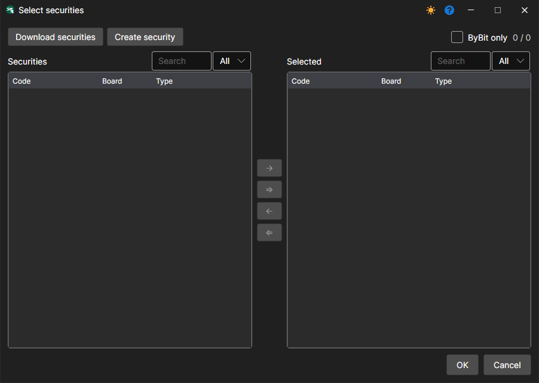

2. The first time, the list on the left is empty: Hydra does not know any instruments yet. Click **Download securities**. The window that opens sets the search conditions; the **All** check box requests the whole list from the source.

   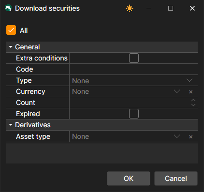

   For a number of sources, instead of the whole list, you can [specify](prepare_for_download/instruments_list.md) the instruments you need.

3. Click **OK**. When the source responds, Hydra reports how many new instruments have been added, and they appear in the list on the left. The counter above the list shows how many instruments are visible and how many are known in total; the **ByBit only** check box hides the instruments that other sources already download.

   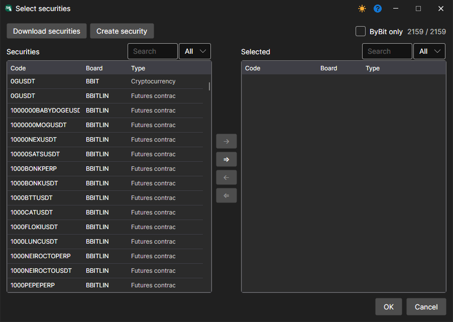

4. Start typing the instrument code in the **Search** field above the list.

   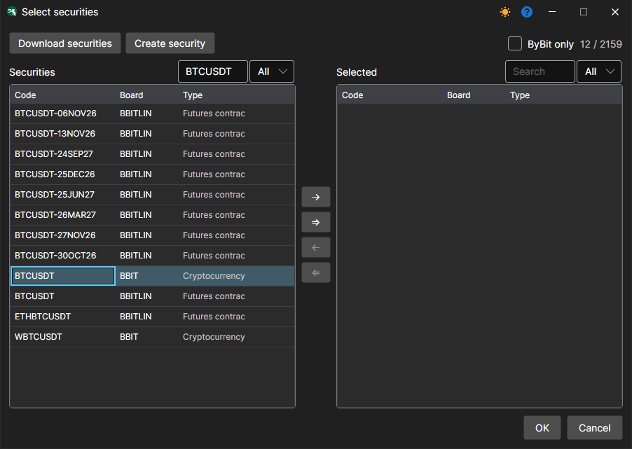

5. Move the instrument to the right with a double-click or the arrow button and click **OK**.

   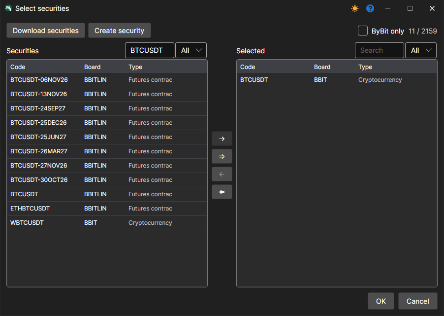

## Data types and period

After the instruments are selected, Hydra asks which data to download for them. Let's mark **Ticks** and five-minute candles **TF: 00:05:00** — each click adds one more type to the selection.

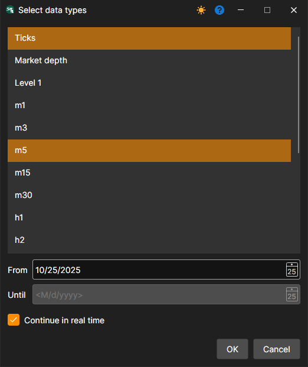

The **From** date is the beginning of the history. The **Continue in real time** check box keeps the source receiving data after the history has been downloaded; the **To** date is not needed with it. How much history the source provides depends on the source itself.

After **OK**, the instrument appears in the source table. The table is a tree: the instrument row contains its code, and below it are the selected data types with their start and end dates.

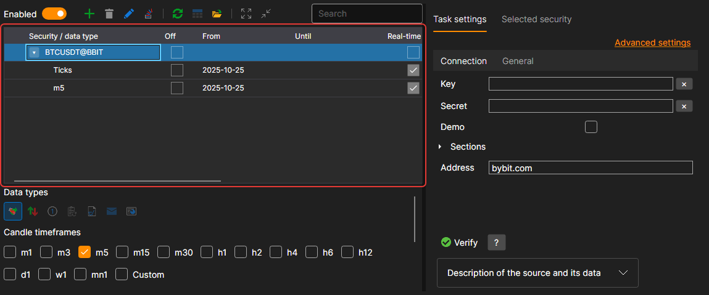

If no data type is selected for an instrument, or its price step, volume step or number of decimal places is not set, the ⚠ icon appears on the left of its row. The tooltip on the icon explains what is missing.

Below the table are the settings of the rows selected in it. Select one or several rows, and the settings apply to all of them at once:

- **Data types** — which data to receive. The set depends on the source.

  

- **Candle timeframes** — which candles to download. The list of timeframes also depends on the source; **Custom** opens a window where [your own candle type](prepare_for_download/custom_candles.md) is set.

  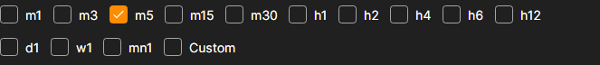

- **From** and **To** — the download period. Without an end date, the source downloads everything available as of today, and if it can work in real time and the **Real-time** check box is selected, it keeps receiving data further.

  **Candle build** — where to take candles from: **Load** — ready-made from the source, **Build** — built by Hydra itself, **Load and build** — load them and build the missing ones. **Build field** — what to build them from: the last trade price, the middle of the spread, the best price, etc. Building candles is convenient when the source does not provide them with the required timeframe.

  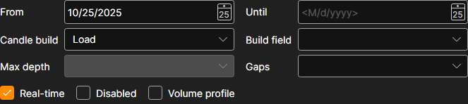

## Downloading

Click **Start** on the toolbar. The source connects and starts downloading. The progress is visible in the **Logs** panel at the bottom of the window, and the status bar counts the received data: **C** — candles, **T** — ticks and so on. Logs are also saved to files in the Hydra folder.

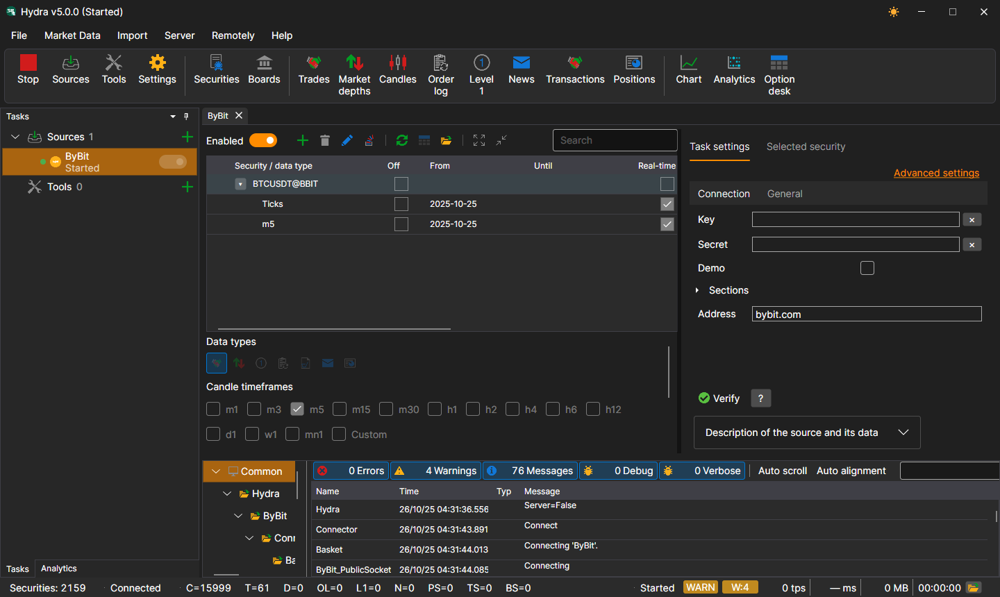

You can also add [other sources](data_sources/select_source.md).

The downloaded data can be [viewed](working_with_data/view_and_export.md), [candles can be built](working_with_data/candles_generation.md) from it, and it can be [exported](working_with_data/export_data.md) to various formats.

**Watch [video tutorial](videos/first_start.md)**.
