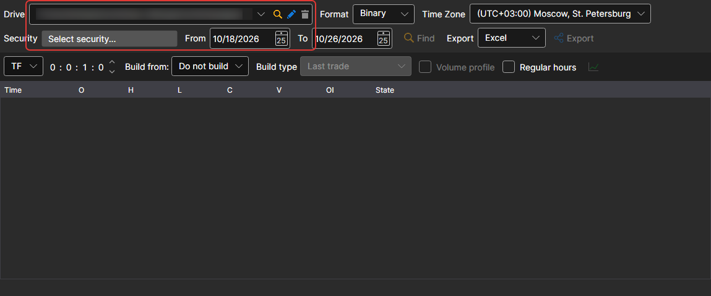
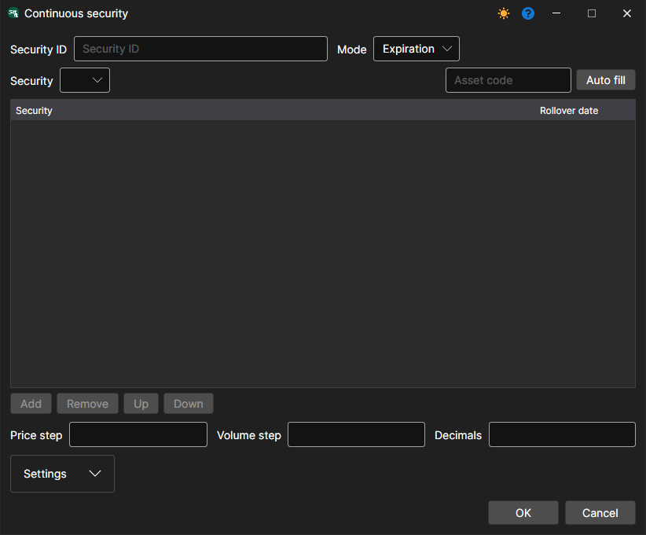
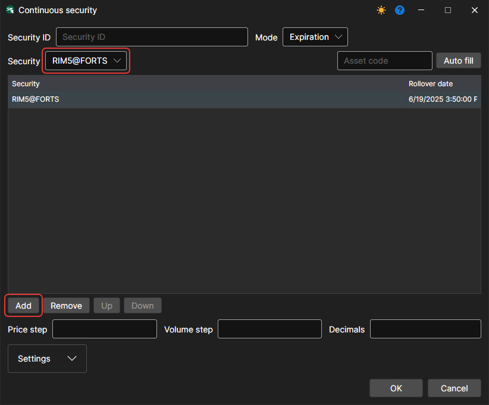
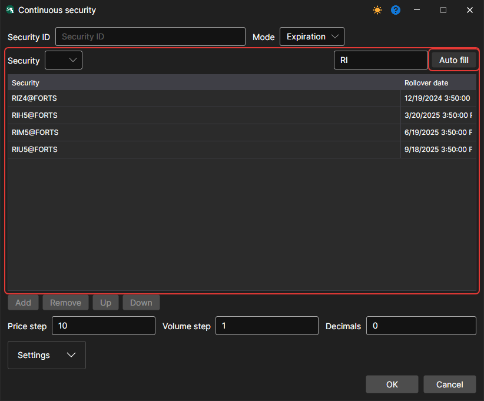
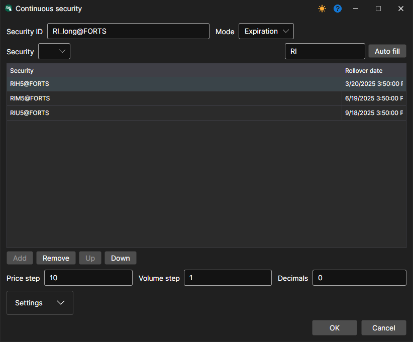
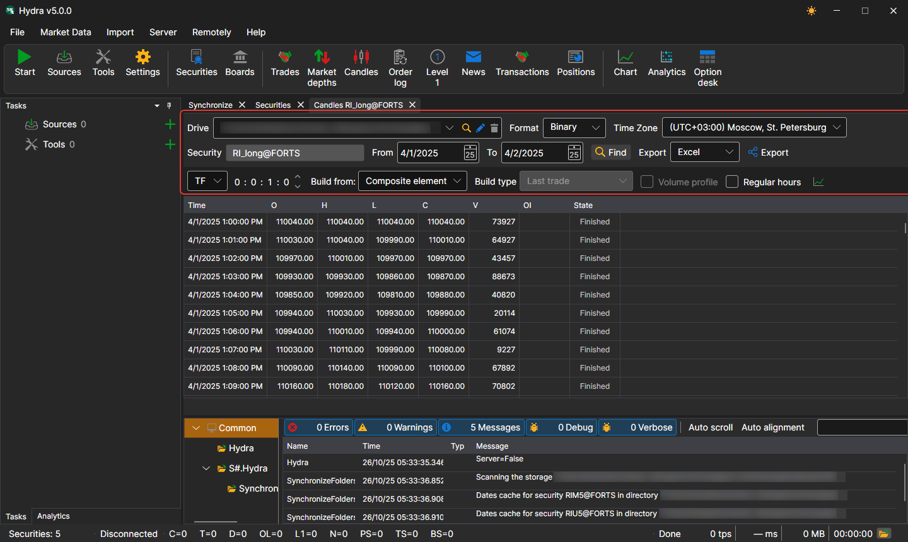

# Continuous futures

The [Hydra](../../hydra.md) program allows the user to combine different types of market data from various contracts into a single continuous instrument.

To do this, select the **Securities** item in the **Market Data** menu, and the **Securities** panel appears. Before combining the data, check which market data is available. Select the path where the data is located and review the instruments that you plan to combine. If there are gaps, download the missing market data (for example, from a supported data source).

As an example, consider combining E-mini S&P 500 futures.

1. To create a continuous futures contract, click the **New continuous** button on the **Securities** panel.

   After that, the following window will appear:
2. To create a continuous future, you need to specify a name and add contracts.

   There are two ways to add contracts.
   - Manually: select a contract in the **Security** list and click the **Add** button.
   - If you set the first two letters of the contract in the **Asset code** field, for example, RI, and click the **Auto fill** button, then all the contracts found in the database will be added with their expiration dates.
3. Select the required contracts and set their transition dates. 
4. Next, assign the instrument identifier **ES\_continuous@CME** and click the **OK** button, after which a new instrument will be created.
5. Next, select the [Candles](../working_with_data/view_and_export/candles.md) item in the **Market Data** menu, select the resulting instrument and data period, set the **Composite element** value in the **Build from** field, and then click the  button. 

The generated data can be exported to Excel, XML, JSON or TXT formats. Export is performed using the drop-down list.

