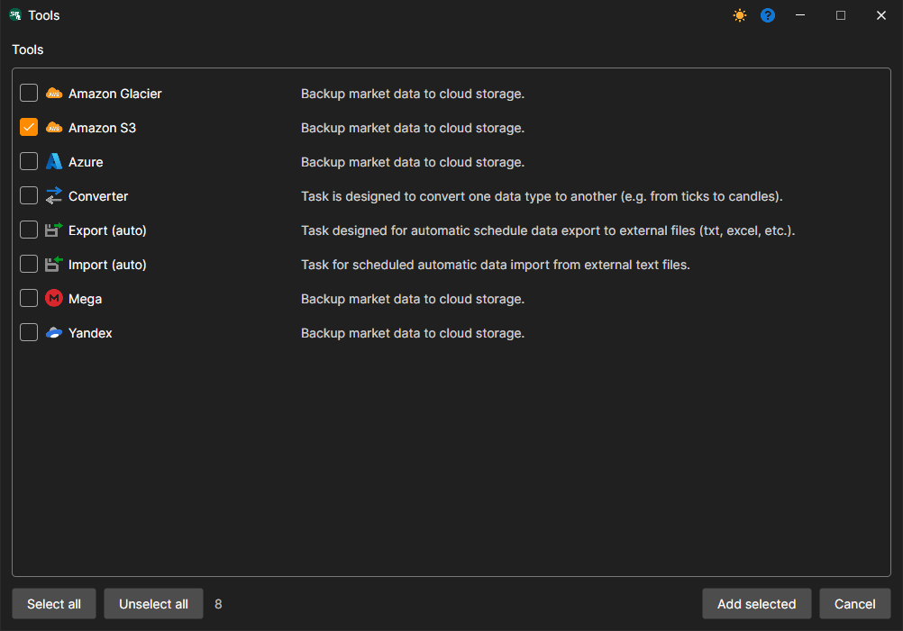
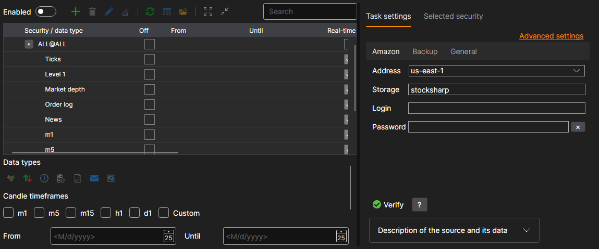

# Hydra settings

The following describes how to create and configure a backup task.

1. To create a task, click the **Tools** button, in the window that opens, select the **Amazon S3** item and click the **Add selected** button. When asked whether to enable the task now, you can answer **No** - the task is enabled with its switch after it is configured.
2. Next, you need to configure the task. The settings are divided into tabs, and the **Advanced settings** link shows all of them as one list.

   **Amazon**
   - **Address** - the region specified in the bucket settings. See [Regions and Endpoints](https://docs.aws.amazon.com/general/latest/gr/rande.html#s3_region).
   - **Storage** - the bucket name.
   - **Login** - the **Access Key ID** access key.
   - **Password** - the **Secret Access Key** access key.

   **Backup**
   - **Folder** - the folder in the cloud to which the data is uploaded. If it is not set, the data is uploaded to the root of the bucket.
   - **Time offset** - an offset in days from the current date, so as not to copy the data of an unfinished trading session.
   - **Errors** - how many times a failed operation (creating a folder, uploading a file) is repeated before the task reports an error.

   **General**
   - **Continue** - continue copying from the last copied date.
   - **Interval of operation** - the interval of operation.
   - **Data directory** - data directory, from which the data for conversion will be received.
   - **Format** - the converted data format: BIN\/CSV.
   - **Max. errors** - the maximum number of errors, upon which the task will be stopped. By default, 0 - the number of errors is ignored.
   - **Header** - task title.
   - **Working hours** - the work schedule of the task. When the check box in the field is selected, the **...** button becomes available, which opens the schedule editor.

   **Logging**
   - **Logging level** - the logging level.
3. After setting up the task, add the instruments that should be saved in the backup storage and click the **Start** button.

## Recommended content

[Creating and configuring an account](setup.md)
