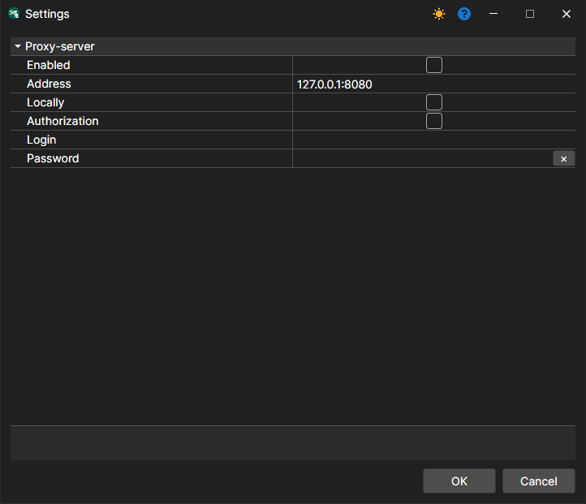

# Network settings

The **File \=\> Proxy settings** menu. (The **Server \=\> Network settings** item is the settings of the [server mode](../server_mode/settings.md).)

It allows you to configure the proxy settings.
