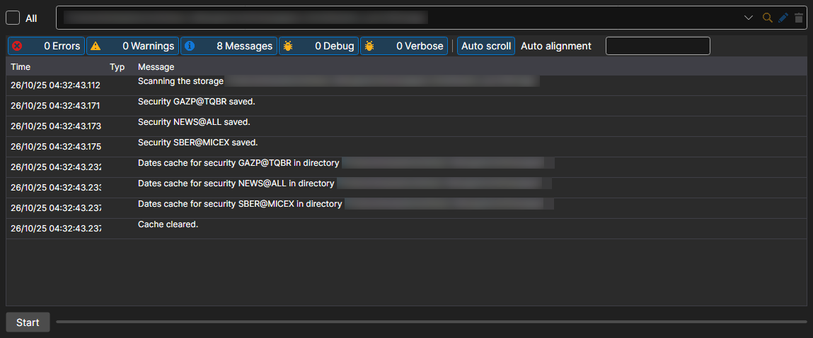

# Synchronization

Menu **Import \=\> Synchronize**.

It allows you to recover the instruments from downloaded files.

The **Import \=\> Build index** item rebuilds the storage index — the list of which data for which days it contains. Hydra also rebuilds the index by itself, at the interval set in the general settings.
