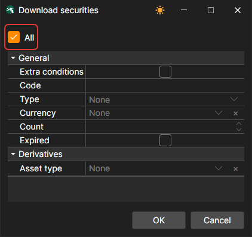
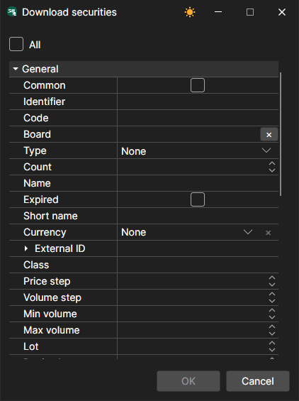
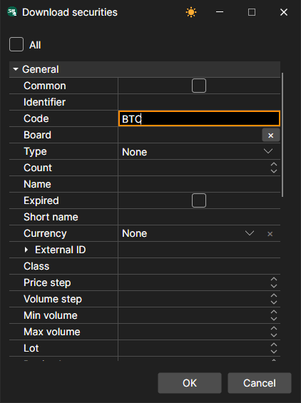
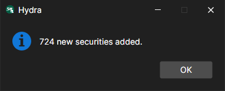
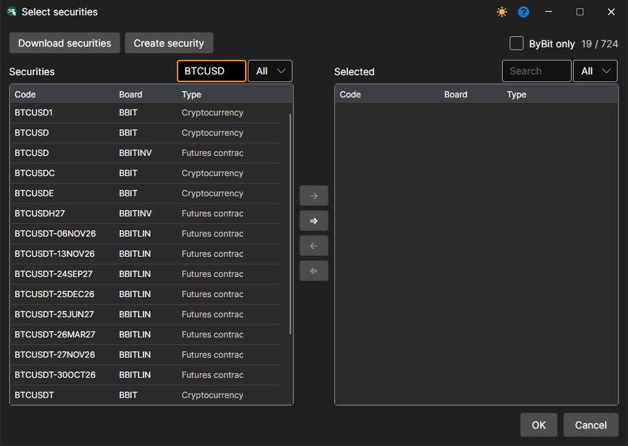
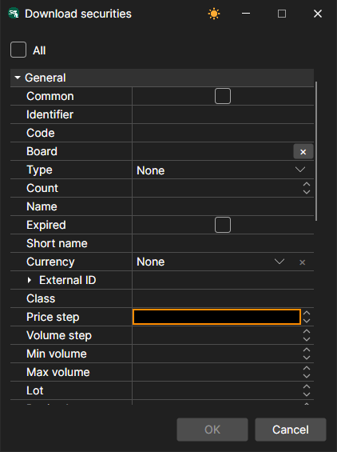
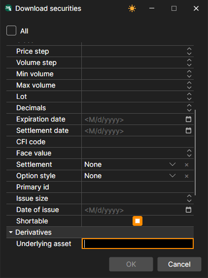

# Instruments list

Setting up the security for downloading.

For a number of sources, it is possible to make settings for downloading the necessary securities.

Let's take an example of downloading securities from the **ByBit** source:

1. Click **Download securities**. By default, the **All** item is selected - all instruments of the source will be downloaded.
2. Clear the **All** mark and select **Extra conditions**. After that, a list of advanced settings for the downloaded security will open; the **Common** mark returns the short list.
3. You need to download the instruments whose code contains BTC. To do this, we specify BTC in the **Code** field and click **OK**.

   After that, the [Hydra](../../hydra.md) program will download all the securities that meet the specified parameters and report how many of them are new. 

Setting allows the user to select various parameters for the downloaded security. 

So, for example, the user can select:

- **Price and volume step**
- **Minimum and maximum volumes**
- **External ID** 
- For options, it allows setting the **Underlying Asset** and **Asset Type** (type of the underlying security). 

**Watch [video tutorial](../videos/instruments_downloading.md)**
