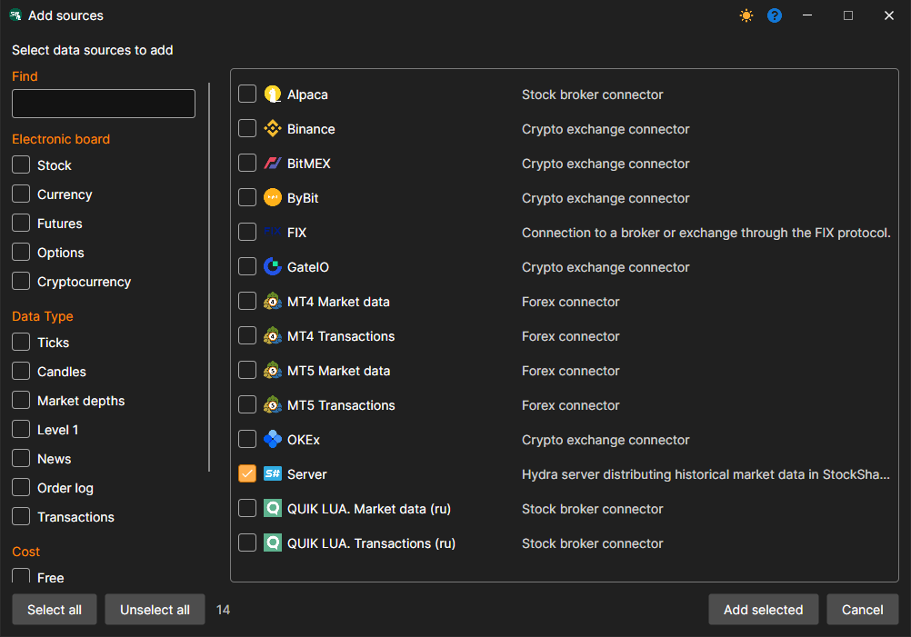
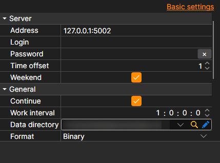

# Connecting a Hydra Client

In server mode, it's possible to connect another Hydra program, which will act as a client and download data to itself. Unlike [Connecting via FIX protocol](fix_fast_connectivity.md), data is transmitted in the form of files in StockSharp format. This makes the source suitable for transferring a large volume of historical data.

The **Server** source is used for connection: mark it in the window that opens with the **+** button of the **Sources** section and click **Add selected**.

**Settings**

**Server**

- **Address** - the address of the Hydra server.
- **Login** - login (required if the server requires authorization).
- **Password** - password (required if the server requires authorization).
- **Time Offset** - a time offset in days from the current date, necessary to prevent downloading incomplete data for the current trading session.
- **Weekend** - whether to skip weekends.

**Main**

- **Continue** - continue downloading from the last downloaded date.
- **Interval of Operation** - operation interval.
- **Data Directory** - the directory with data where the final files in [S#](../../api.md) format will be saved.
- **Format** - the format of data: BIN/CSV.
- **Max. Errors** - the maximum number of errors, upon reaching which the task will be stopped. By default, 0 - the number of errors is ignored.
- **Title** - the title of the task.
- **Working Hours** - the work schedule of the task.
- **Validation** - what to do with data that has not passed validation: nothing, delete it or stop the subscription.

**Remotely**

- **Enabled** - control the task remotely.
- **Notification** - the channel to which notifications about the task arrive.
- **Logging level** - which task messages to send to the channel.

**Logging**

- **Logging Level** - the level of logging.
