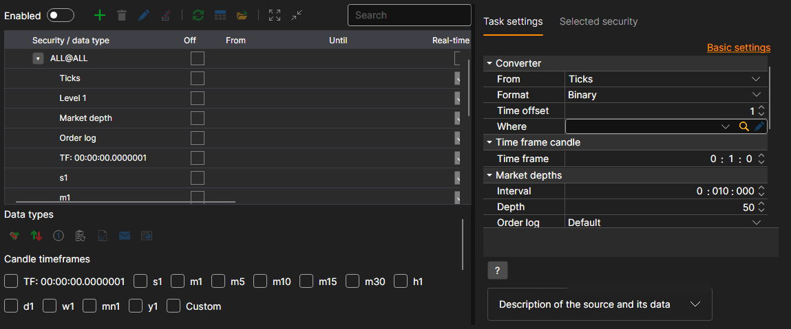
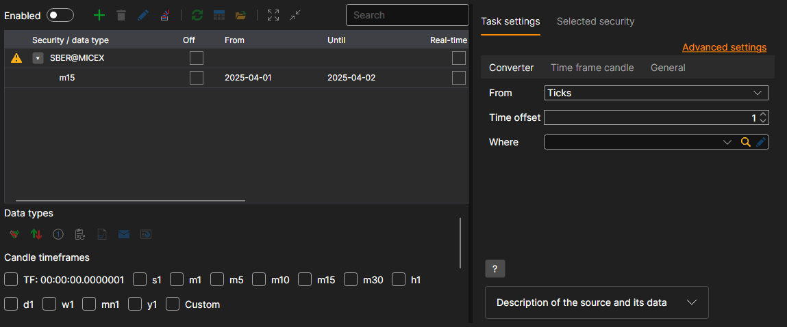
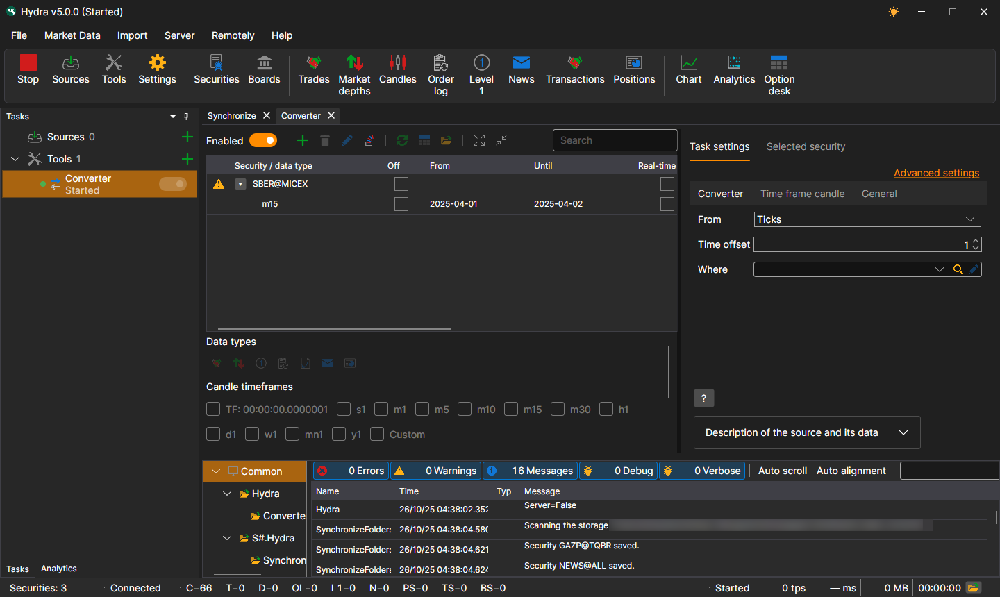
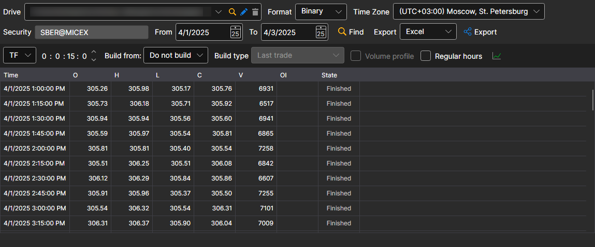

# Converter

The task converts exchange data. For example, from the Order Logs to ticks or from ticks to candles, etc.

The task is added with the **Tools** button: in the window that opens, mark the **Converter** item and click the **Add selected** button. The task settings are divided into tabs, and the **Advanced settings** link shows all of them as one list.

**Converter**

- **From** - what data type will be converted.
- **Format** - the format of the converted data: BIN\/CSV.
- **Time offset** - the time offset in days from the date the task was started. This prevents converting an incomplete day. If real-time data conversion is configured, the update interval can leave the current day only partially converted. Use the time offset to avoid that.
- **Where** - the data directory where the converted data will be saved.

**Time frame candle**

- **Time frame** - the time frame of the candles from which the conversion is performed, if candles are selected in the **From** field.

**Order books**

- **Interval** - order book generation interval.
- **Depth** - maximum depth of order book generation.
- **Order log** - how to build order books from the order log.

  **By default** is suitable in most cases. If a connection has its own order log format (for example, **Plaza** of the Moscow Exchange), this format appears in the list once the connection is established.

**General**

- **Continue** - continue converting from the last converted date.
- **Interval of operation** - the interval of operation.
- **Data directory** - data directory, from where the data for conversion will be received.
- **Format** - the format of the data being converted: BIN\/CSV.
- **Max. errors** - the maximum number of errors, upon which the task will be stopped. By default, 0 - the number of errors is ignored.
- **Header** - Converter.
- **Working hours** - the work schedule of the task. 

**Logging**

- **Logging level** - the logging level.

Let's consider an example of data conversion.

1. Go to the **Converter** task and add an instrument with the **+** button above the table. 
2. In the window that appears, set the data type that we should receive during conversion, and the period. The data type from which the conversion is performed is set in the **From** setting.

   For example, you need to convert Ticks into candles with a Time Frame of 15 minutes.

   > [!TIP]
   > IMPORTANT\! The requested data period must match the period available for conversion; otherwise, the data will not be converted. In the settings, specify the correct source data format so that it matches the format of the data being converted.
3. Specify the required directories. Time offset. Operation interval.
4. Enable the task with the **Enabled** switch and start the conversion with the **Start** button. 

It can be seen that the data has been converted. [Let's review](../working_with_data/view_and_export.md) the resulting data. 

This function is similar to [getting the required market data](../working_with_data/any_market_data_types.md) from another data type. 

**Watch [video tutorial](../videos/converter_task.md)**
