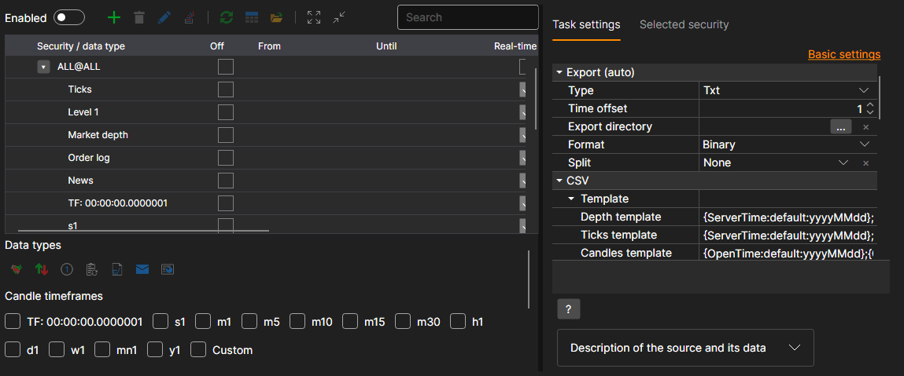
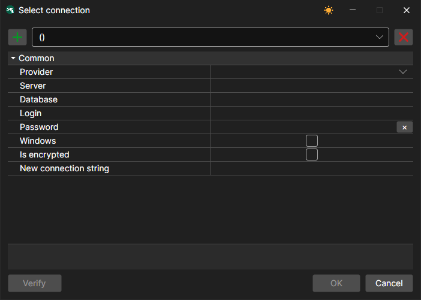
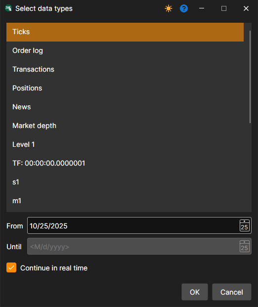
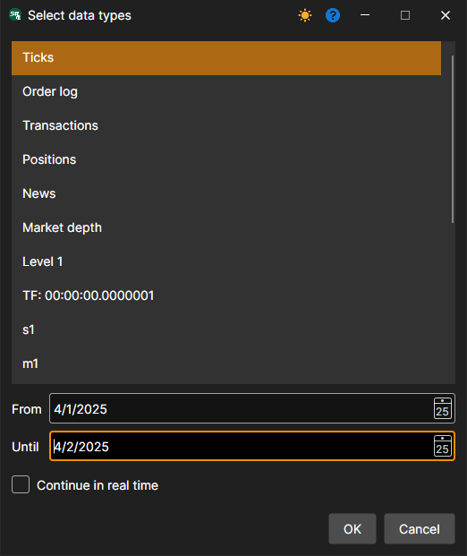
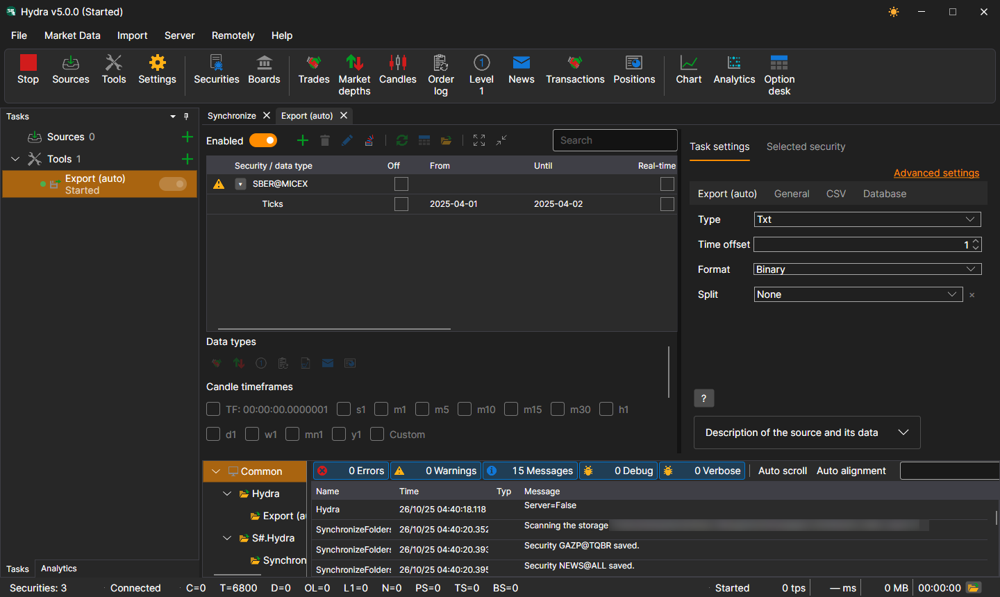

# Export (auto)

The task exports exchange data into various formats: Excel, xml, sql, bin, Json or txt.

The task is added with the **Tools** button: in the window that opens, mark the **Export (auto)** item and click the **Add selected** button. The task settings are divided into tabs, and the **Advanced settings** link shows all of them as one list.



**Export (auto)**

- **Type** - export type (format).
- **Time offset** - time offset in days.
- **Export directory** - directory where data will be exported. If it is not set, the files are saved to the data directory.
- **Format** - data format.
- **Split** - split type: by days, months or years.

**Database**

- **Connection** - connection to the database. Used in case of export via SQL.
- **Packet** - the size of transmitted data packet. By default, the size is 50 elements. Used in case of export via SQL.
- **Uniqueness** - check the data uniqueness in database. Affects performance. Enabled by default. Used in case of export via SQL.

> [!TIP]
> When using export via SQL, you need to set the connection to the database

The connection window is opened with the magnifier button in the **Connection** field, and the **+** button in it adds a new connection:



- **Provider** - provider settings.
- **Server** - server address or path to database.
- **Database** - database name. Not used for SQLite.
- **Login** - login to access the database. Not used for anonymous access.
- **Password** - password for accessing the database. Not used for anonymous access.
- **Windows** - use the current Windows account to connect to the database.
- **Is encrypted** - encrypt the connection to the server.
- **New connection string** - ready-made connection string.

> [!TIP]
> You can check the connection to database using the **Check** button.

**CSV**

- **Template** - templates for each type of exported data.
- **Header** - the header in the first line. If an empty string is passed, the header will not be added to the file.
- **File name format** - the format for recording the exported file name.

**General**

- **Continue** - continue exporting from the last exported date.
- **Interval of operation** - the interval of operation.
- **Data directory** - data directory from which the exported data is taken.
- **Format** - data format: BIN\/CSV.
- **Max. errors** - the maximum number of errors, upon which the task will be stopped. By default, 0 - the number of errors is ignored.
- **Header** - task title.
- **Working hours** - the work schedule of the task. 

**Logging**

- **Logging level** - the logging level.

Let's consider an example of automatic export:

1. Select a security with the **+** button above the table.
2. Set up the market data that needs to be exported.
3. Set the export period. If the download of market data in real time is configured, then you can omit the end date of period. In this case, the data will be exported in real time, according to the work interval (data update). 
4. Setting up directories. Operation interval. Data type. Data format.
5. Enable the task with the **Enabled** switch and start the export with the **Start** button.

Let's view the exported data. The SBER@MICEX ticks for April 1 and 2, exported to the **Txt** type with the default tick template, are in the `trades_SBER@MICEX_2025_04_01_2025_04_02.csv` file and begin like this:

```
20250401;10:00:00.000000;15500000;305.26;88;Buy
20250401;10:00:09.000000;15500001;305.23;2;Sell
20250401;10:00:18.000000;15500002;305.20;48;Sell
20250401;10:00:27.000000;15500003;305.22;46;Buy
20250401;10:00:36.000000;15500004;305.28;105;Sell
```

**Watch [video tutorial](../videos/export_task.md)**
