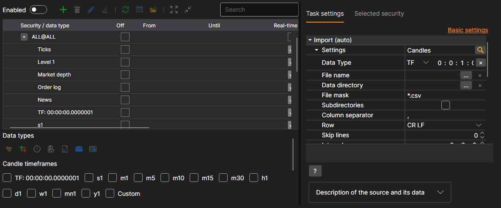
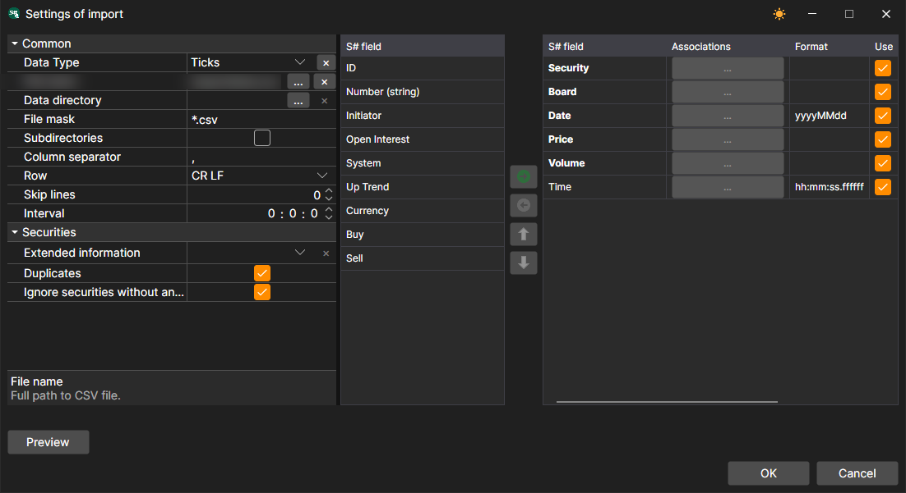
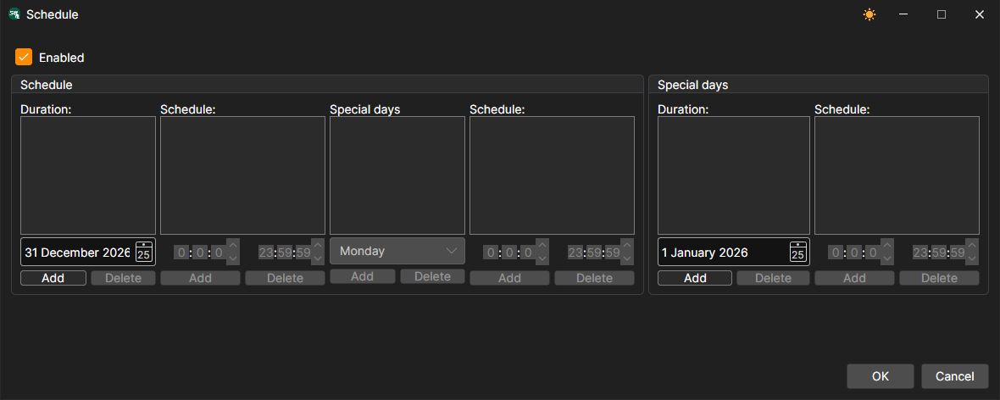
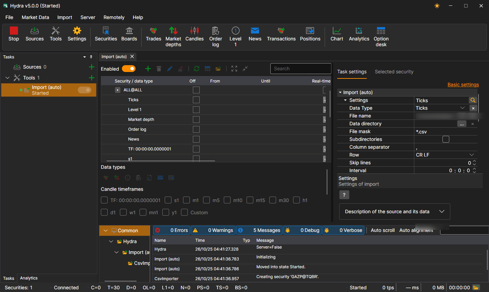

# Import (auto)

The task performs automatic import of exchange data from files in the specified directory according to the specified file mask.

The task is added with the **Tools** button: in the window that opens, mark the **Import (auto)** item and click the **Add selected** button. The **Advanced settings** link shows all the task settings as one list.

What to import and from where is set in the **Settings** row. The magnifier button in this row opens a window where, in addition to the same settings, the file columns are matched with the S# fields - the same way as on the [Importing](../importing.md) tab:

**Settings**

- **Data type** - type of imported data.
- **Filename** - full path to the file.
- **Data directory** - the directory with files, if not a single file but all suitable files of the directory are imported.
- **File mask** - file mask that is used when scanning the directory. For example, candles\*.csv.
- **Subdirectories** - include subdirectories.
- **Column separator** - column separator. Tabulation is denoted by TAB.
- **Row** - the line ending in the file: CR LF, LF or CR.
- **Skip lines** - the number of lines to skip from the beginning of file (if they contain meta information).
- **Interval** - the frequency of data updates.
- **Extended information** - save extended imported fields in the extended information storage.
- **Duplicates** - whether duplicate instruments need to be updated if they already exist.
- **Ignore without ID** - ignore instruments without an identifier.

**General**

- **Continue** - continue importing from the last imported date.
- **Interval of operation** - the interval of operation.
- **Data directory** - data directory, from where the data for conversion will be received.
- **Format** - the converted data format: BIN\/CSV.
- **Max. errors** - the maximum number of errors, upon which the task will be stopped. By default, 0 - the number of errors is ignored.
- **Header** - task title.
- **Working hours** - the work schedule of the task. 

**Logging**

- **Logging level** - the logging level.

Let's consider an example of automatic import of ticks. In the `ticks.csv` file, each trade is written as a line like `GAZP,TQBR,20250401,128.58,74,10:00:02.000000`: instrument, board, date, price, volume and time.

1. With the magnifier button in the **Settings** row, open the import settings window.
2. Select the **Ticks** data type and specify the path to the file in the **File name** field.
3. Add the **Time** field to the S# fields: the required fields - instrument, board, date, price and volume - are already in the order in which the columns go in the file, and the time is added after them. Click **OK**.
4. Enable the task with the **Enabled** switch and start the import with the **Start** button. 
