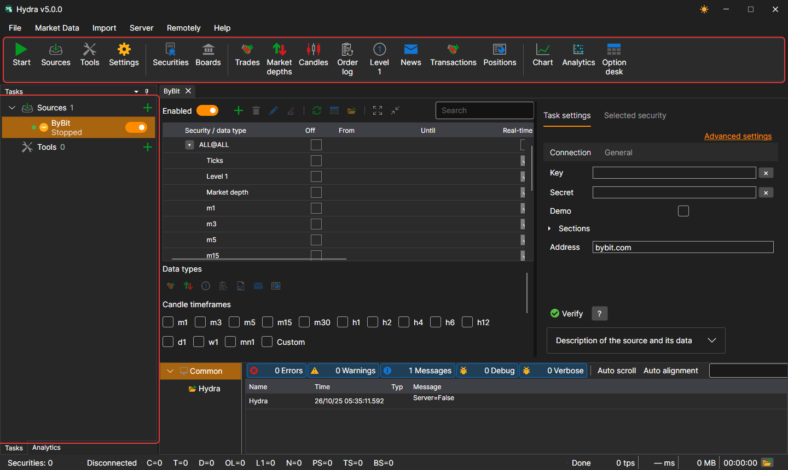
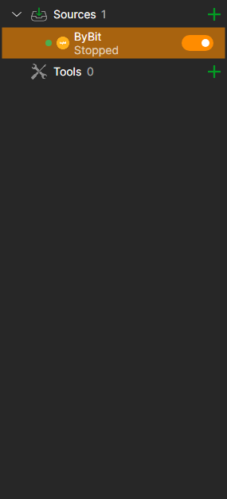
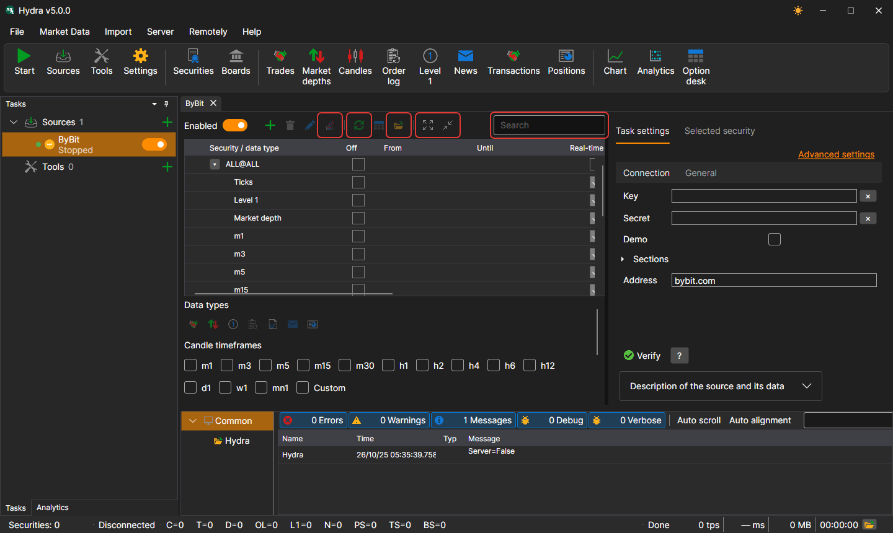

# User interface

The [Hydra](../hydra.md) window consists of a menu, a command bar below it, the **Tasks** and **Analytics** panels on the left, the **Logs** panel at the bottom and documents in the center: panels of sources, tools and market data. At the bottom of the window is the status bar.

## Menu

- **File** — adding [sources](data_sources.md) and tools, [general settings](misc/settings.md), [proxy settings](misc/network_settings.md), [settings reset](misc/settings_reset.md) and exit.
- **Market Data** — panels for viewing the market data of the storage: securities, boards, trades, order books, candles, order log, Level 1, news, transactions, positions, as well as the [chart](working_with_data/chart.md), analytics and the option desk.
- **Import** — [import](importing.md) of data from files, [synchronization](misc/synchronization.md) of the storage and building its index.
- **Server** — the [server mode](server_mode/settings.md): enabling it, network settings, users and subscriptions of clients.
- **Remotely** — remote control of Hydra via the Telegram bot ([Control Panel](../telegram_services/control_panel.md)) and the **Channels** window with the list of Telegram channels to which Hydra sends messages.
- **Help** — changing the theme, contacting the StockSharp team, reporting a problem, documentation and the **About** window.

On macOS, the menu moves to the system menu bar.

## Command bar

Below the menu is the command bar with the most frequent actions: **Start / stop all tasks**, adding sources and tools, settings; the **Securities** and **Boards** panels; the market data panels — trades, order books, candles, order log, Level 1, news, transactions and positions; **Chart**, **Analytics** and **Option desk**.

## Tasks

On the **Tasks** panel on the left, the tasks are arranged in the **Sources** and **Tools** groups. A group shows the number of its tasks and the **+** button that adds a new one. A task shows a dot (green if the task is enabled), an icon, a name, a line with its current state and a switch; the clock icon shows that the task has working time set. A double-click opens the task panel, and a right-click opens a menu with the **Open** and **Delete** items.

While nothing is open in the center of the window, a welcome screen with the **Add sources** and **Add tools** buttons is shown there.

While a long operation is in progress — for example, a large storage is being read or a source is being added — the window is covered with a semi-transparent overlay describing what is being done.

## Task panel

Above the instruments table of a source are the search, the **Enabled** switch, the buttons for adding, deleting and editing instruments, **Add ALL@** (all instruments of the source at once), date synchronization, going to the data and to the storage folder, collapsing and expanding rows. The settings tab has a connection check button and the source description, and the **Selected security** tab shows the properties of the instrument selected in the table.

## Status bar

At the bottom of the window you can see how many instruments are in the storage, whether Hydra is connected, how much data of each kind has been received since the start, what the program is busy with now, and the last warning or error of the log. The folder button opens the logs folder. While a long operation is in progress — reading a large storage, adding a source — the window is covered with an overlay describing the work.

## See also

[First start](first_start.md)

[Data sources](data_sources.md)
