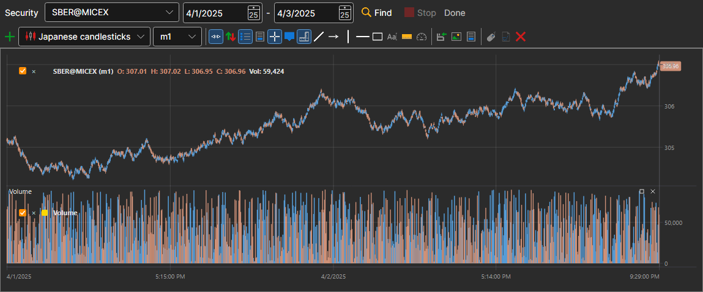

# Chart

The **Chart** panel shows the candles of any instrument that is in the storage. It is opened with the **Market Data → Chart** item or with the **Chart** button on the command bar.

In the row above the chart, you select the **Security** and the period — the start date and the end date — and then click **Find**. The candles are read from the storage and drawn as they are read; **Stop** interrupts the reading, and the line next to the buttons shows how the work is going.

Below is a full-featured chart, the same as in [Terminal](../../terminal/user_interface/components/chart.md): with a button bar, candle styles, indicators and drawing. You can add an [indicator](view_and_export/indicators.md) to the chart, and the **Stop drawing** button stops a long drawing of a large period.

## See also

[Candle Generation](candles_generation.md)

[View and export](view_and_export.md)
