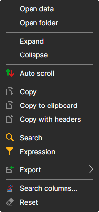
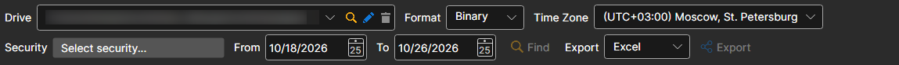
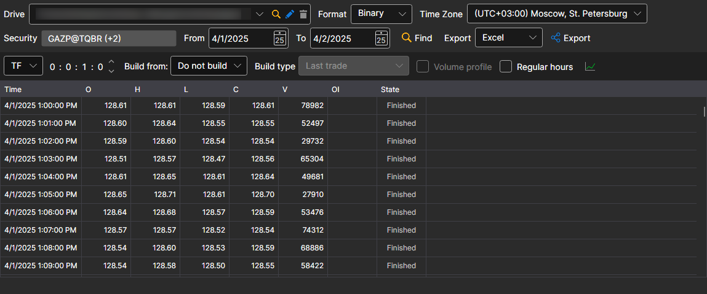
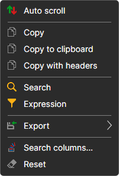

# View and export

The received [Hydra](../../hydra.md) data can be viewed in special panels. 

To do this, select one of the following items in the **Market Data** menu: [Ticks](view_and_export/ticks.md), [Order books](view_and_export/order_books.md), [Candles generation](candles_generation.md), [Order log](view_and_export/order_log.md), [Level 1 ](view_and_export/level_1_.md), [News](view_and_export/news.md), [Transactions](view_and_export/transactions.md), [Option desk](view_and_export/option_desk.md), [Indicators](view_and_export/indicators.md), [Positions](view_and_export/positions.md).

The panel with the data of a task is also opened from its instruments table: by double-clicking a data type or with the **Open data** item of the context menu, as shown in the figure.

Each panel contains a general interface of the settings as follows:

- The top line indicates the market data storage (**Drive**), its **Format** (binary or CSV) and the **Time Zone** in which the time is shown.
- The second line selects the securities and the period for which the data will be requested. When you click the **Select security...** button, the security selection window will appear, in which you can select one or several securities. If several securities are selected, then during the subsequent export to Excel or CSV, the program will automatically sort the data of different securities into different files.
- The found data is loaded into the table in portions of a thousand rows: the next portion is loaded by itself when the table is scrolled to the end, so you can scroll as far as you like without waiting for the whole period to load. Sorting by a column orders the rows already loaded, and the export with the panel buttons writes all the data for the selected period, not only the loaded rows.
- If the data was received from sources whose time zone does not match the current time zone, you can adjust the time zone. After building, the data will be shown in the zone selected by the user. 
- Since a number of sources do not provide a possibility to download some data, the program provides the [Build from](any_market_data_types.md) field. Using this field, the user can build market data from another type of market data. The same function can be used to build market data without additional download, using already existing data as a basis. 
- After the above parameters are selected, you should click the **Find**  button. While the search or export is in progress, its progress and the **Stop** button are shown under the settings rows. When the export is finished, the **Open file** or **Open folder** button with its result appears in the same place.

The context menu of the table with values allows you to enable automatic scrolling, copy the selected rows to the clipboard, find a value, filter rows with an expression, export the table to a file, to the clipboard or for printing, select the shown columns and reset their layout.

