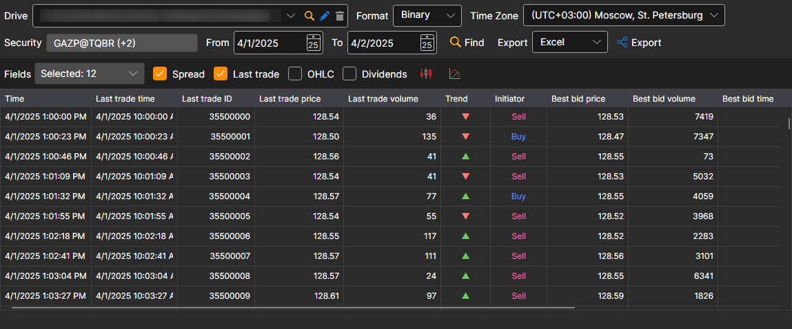
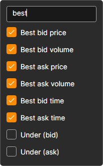

# Level 1 

In the window that appears, select the securities, the required time interval and click the  button:

The **Fields** list sets which Level 1 values are shown in the table and included in the export. Mark the required fields in the drop-down list; the search line at the top of the list leaves only the fields whose name contains the typed text:

The received values can be [exported to the required format](../export_data.md).
