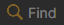
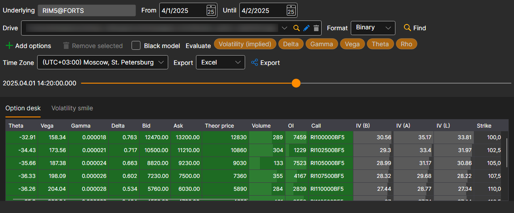
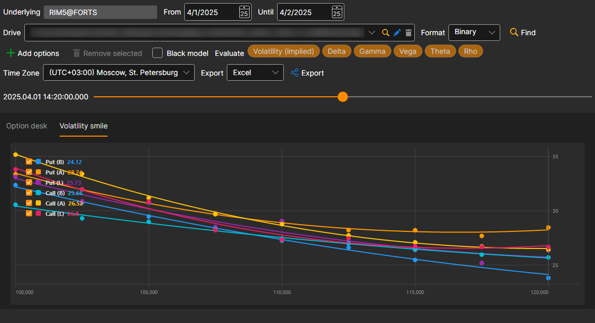

# Option desk

In the window that appears, select the underlying asset — the options on it are added to the desk by themselves, and the time range is set to the one for which the storage has data. The **Add options** button adds other options, and the **Remove selected** button removes unnecessary ones. Then click the  button:

If there is no history of the Greeks, but there is data on the spread, the main Greeks (Delta, Gamma, Vega, Theta, Rho, Volatility (implied)) can be calculated: to do this, mark them in the **Evaluate** field. Volatility is calculated from the bid, ask and last trade prices, and the other Greeks from the volatility of the middle of the spread.

The slider above the desk moves it to any moment of the loaded history; the time of this moment is shown to the left of the slider. When the slider reaches the last loaded moment, the next part of the history is loaded.

To view the **Volatility Smile**, you need to go to the **Volatility Smile** tab.

The calculated values can be [exported to the required format](../export_data.md).
