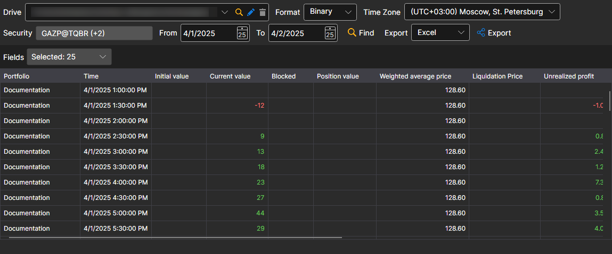

# Positions

In the window that appears, select the securities, the required time interval and click the  button:

The **Fields** list sets which position values are shown in the table and included in the export.

The received values can be [exported to the required format](../export_data.md).
