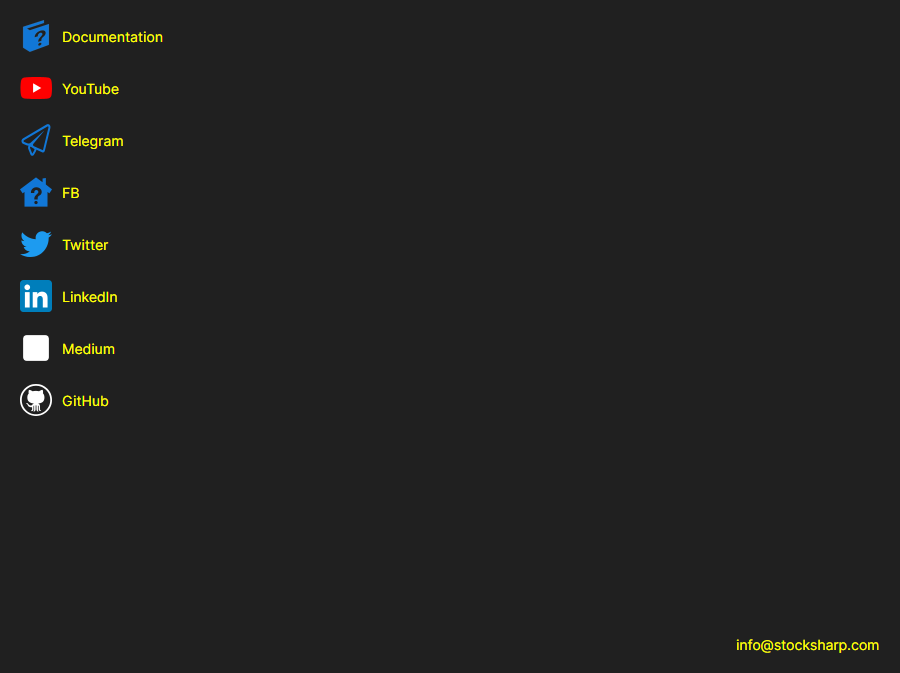

# Help

The **Help** page is opened with the tab of the same name at the top of the [Installer](../installer.md) window.

The page collects the links people most often go to from [Installer](../installer.md): **Documentation**, **YouTube**, **Telegram** (the support chat), **Twitter**, **Dzen** and **GitHub**. A link opens in the default browser of the system. At the bottom of the page is the email address at which you can write to the company.

You can report a problem with the button in the window title — it is available on any page. If [Installer](../installer.md) behaved differently than expected, attach the records from the [Logs](logs.md) page to the message — they show what exactly was happening.

## See also

[Logs](logs.md)
