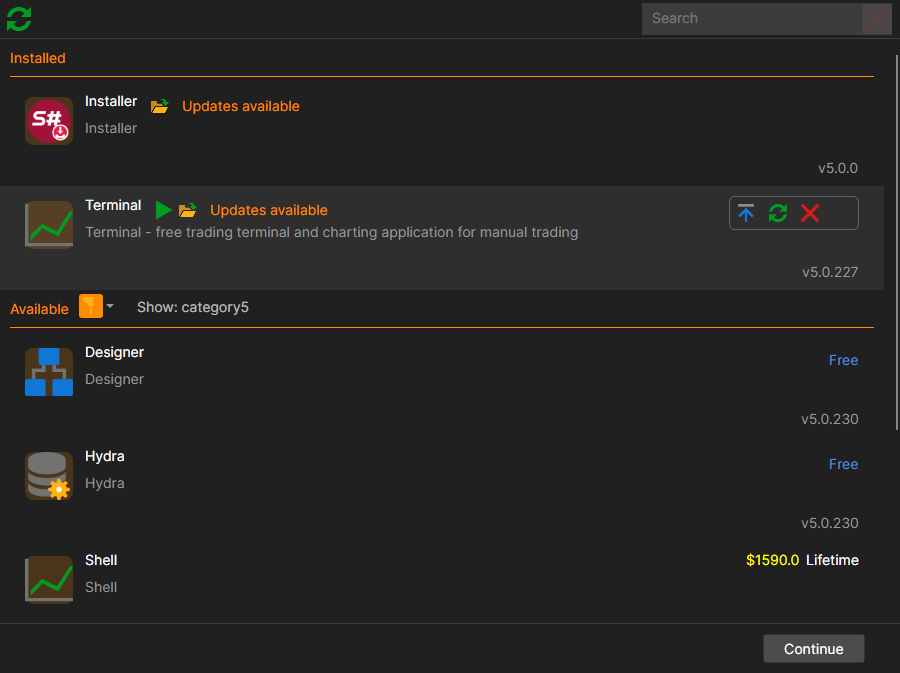
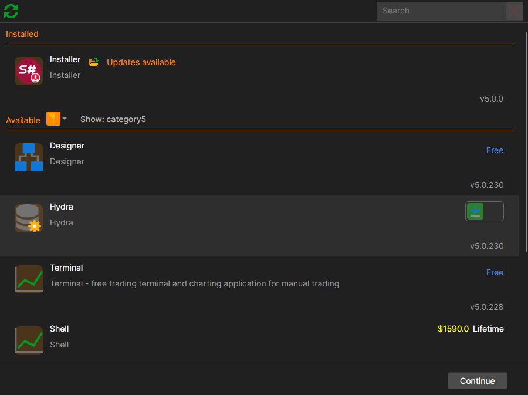
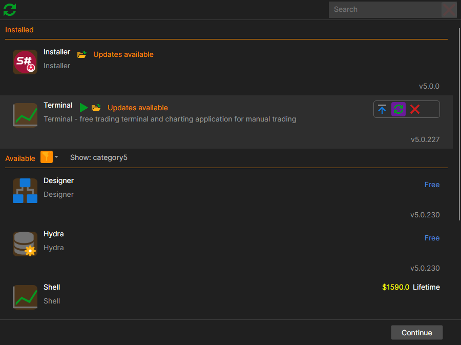
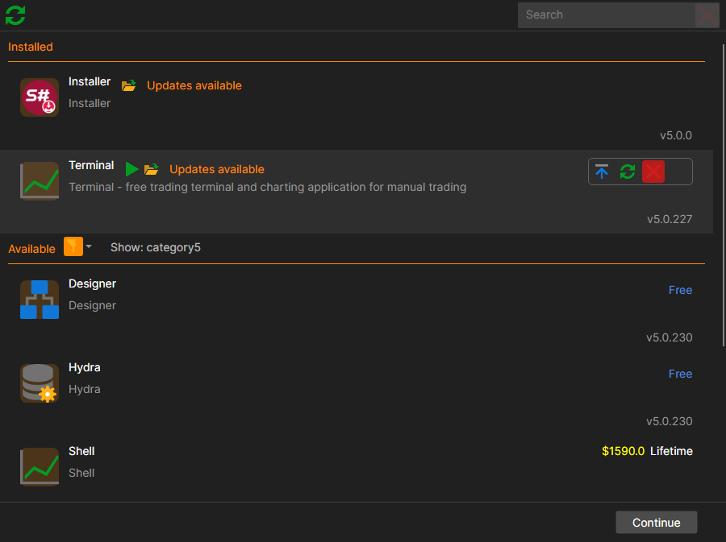
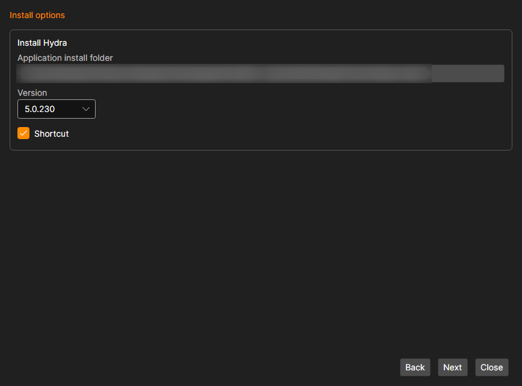

# Install and remove apps

Everything [Installer](../installer.md) does with programs is done on the **Applications** tab: installing, updating, repairing and removing. An action is marked for a product in the list, and all the marked actions are performed at once.

## Catalog

The list is split into two parts: **Installed** — what is already on this computer, and **Available** — what can be installed. If a part has nothing in it, **Empty** is shown instead.

The following help you find what you need:

- the **Search** field above the list — the list narrows as you type, and the cross next to it brings the whole list back;
- the funnel at the **Available** heading — a filter by product type; the **All** button clears it;
- the button with a circular arrow at the top left — **Force check updates**: it asks the store whether anything new has been released, without waiting for the next scheduled check.

An installed product shows its version in its row, and if a new version has been released, the **Updates available** label.

## License agreement

At the bottom of the window is a check box with the consent and a link to the text of the agreement. Until it is accepted, the **Continue** button stays unavailable, whatever is marked. The consent is accepted once and on the server side — after that, the check box is no longer shown, and it cannot be cleared back.

## What to do with a product

Each row has a set of buttons on the right, of which one is selected. Which of them are present depends on the product:

| Button | When available | What it does |
|---|---|---|
| **Install** | the product is not installed | installs it |
| **Update** | installed, and a new version has been released | updates it |
| **Repair** | installed | installs it again on top, without touching the settings |
| **Delete** | installed | removes it |
| **Skip** | always | does nothing with this product |

A product that is not installed has a single choice — to install it:

An installed one has repair:

and removal:

The **Continue** button at the bottom right becomes active as soon as at least one action is marked. You can mark several products at once — for example, update one and remove another. When everything is marked, click **Continue** at the bottom right.

## Wizard

Next, the window shows a three-step wizard instead of the list.

1. **Applications** — what exactly will be done. Check the list and click **Continue**.
2. **Install options** 

   Each action has its own settings here:

   - **Application install folder** — selected with a button. **IMPORTANT\!** The folder must be empty.
   - **Version** and **Recipient** — which version is installed and for whom.
   - **Shortcut** — create a shortcut on the desktop.
   - **Remove the application data folder** — only when removing: delete the program's settings and downloaded data together with it. Without this check box, they remain.
   - **Plugins** — for programs that support them: which connectors to install together with the product.
   - **Install main application parameters** — for a product with plugins, you can clear this check box and work only with the plugins, without touching the program itself.

   Click **Next**.
3. **Following actions will be executed** — the last check. Click **Execute**.

While the work is in progress, **In progress. Please wait...** is shown, and when it is finished, **Done**. The **Close** button returns to the list; **Back** at any step leads to the previous one.

If something has failed, the error text is shown right in the wizard, and the details are on the [Logs](logs.md) page.

**Watch [video tutorial](videos/install_and_remove_apps.md)**

## Recommended content

[Update apps](update_apps.md)

[Logs](logs.md)
