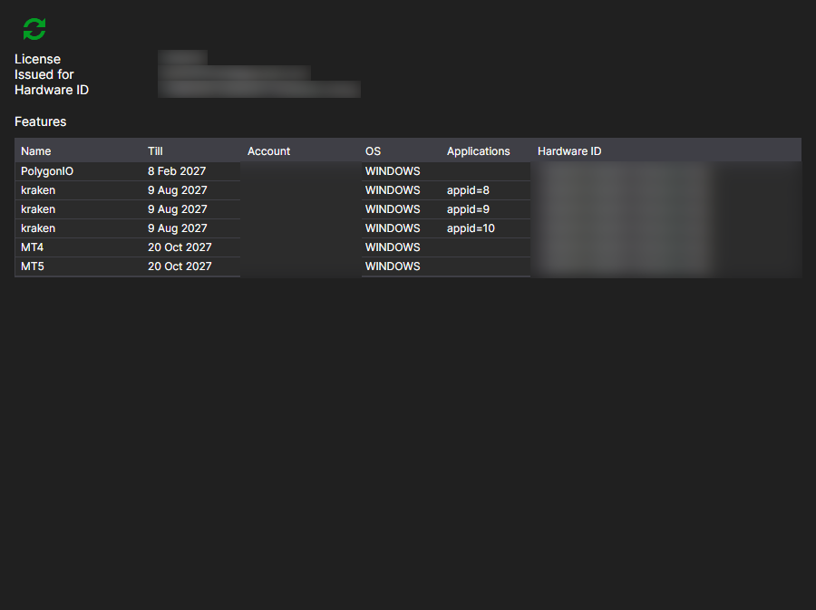

# Licenses

The **Licenses** page is opened with the tab of the same name at the top of the [Installer](../installer.md) window and is available after signing in to the account.

Here you can see which license has been issued to this account and what it entitles you to.

- **Issued for** — who the license is issued to and which computer it is bound to: **Hardware ID** and **OS**. By this binding, the server decides whether the license is valid on the current machine.
- **Till** — the expiration date.
- **Applications** — the programs the license covers.
- **Features** — what exactly is allowed: connections to venues, the number of instruments, access to the source code and so on.

The **Refresh license** button requests the data from the server again. It makes sense to click it after a purchase or a renewal: [Installer](../installer.md) reads the license when you sign in, and a change made on the website later does not appear in the window by itself.

If there is no license, the page says so. You can get one on the [Subscription plans](tariffs.md) page.

## See also

[Subscription plans](tariffs.md)
