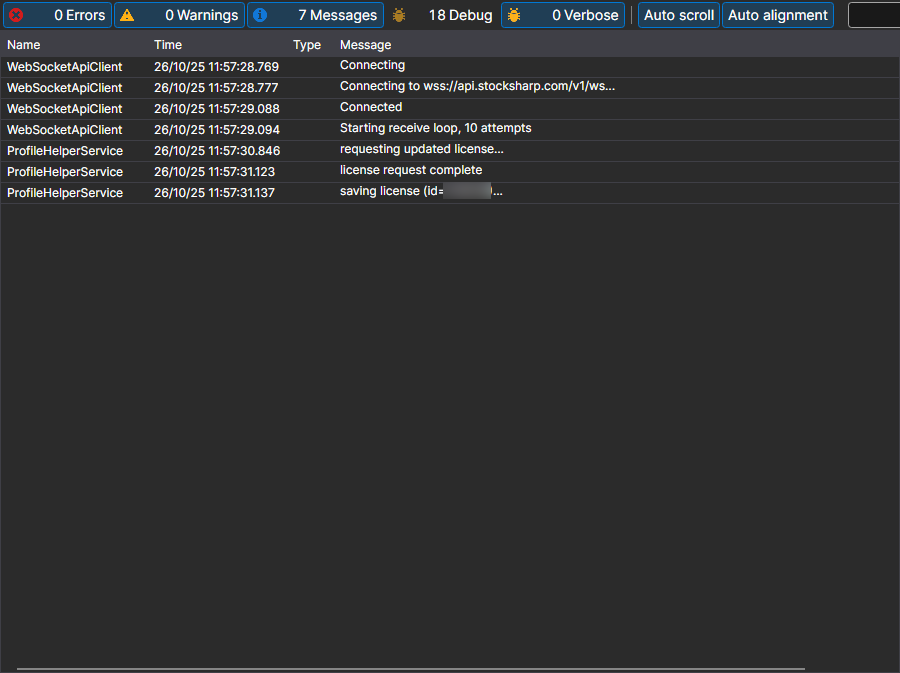

# Logs

The **Logs** page is opened with the tab of the same name at the top of the [Installer](../installer.md) window.

Here [Installer](../installer.md) writes what it was doing: which server it contacted, which packages it downloaded, where it installed them and where it stopped. This is the first place to look if an installation or an update has ended with an error.

Each record contains the time, the level (error, warning, message) and the text. How detailed the log is depends on the **Logging** parameter on the [Settings](settings.md) page: when contacting support, it is worth raising it and repeating the action that failed — then the log will contain the cause, not only the fact of the error.

## See also

[Settings](settings.md)
