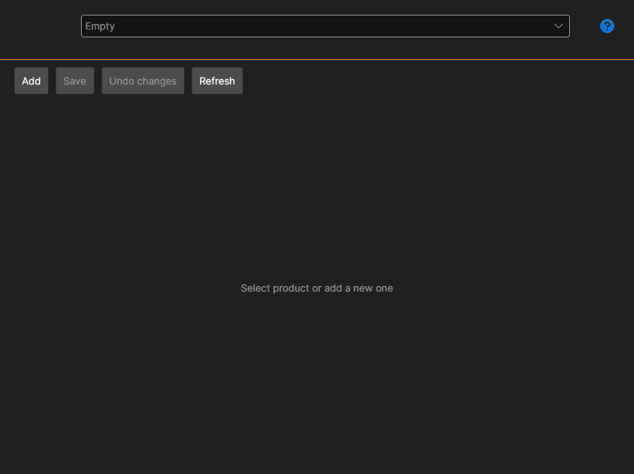

# My products

The **My products** page is opened with the tab of the same name at the top of the [Installer](../installer.md) window and is available after signing in to the account.

The page is needed by those who publish products in the [store](https://stocksharp.com/en/store/) themselves — robots, indicators, connectors. A buyer does not need it: installing and updating are described in the [Install and remove apps](install_and_remove_apps.md) and [Update apps](update_apps.md) sections.

## Product card

The product is selected in the list at the top; the **Add** button creates a new one.

- **Name** and **Description** — what the buyer will see in the store.
- **Nuget package id** — the name under which the package goes to NuGet. Next to it, the full form of the name is shown.
- **Content type** and **Area** — what kind of product it is and where it is used.
- **Categories** — the store sections in which the product will be visible.
- **Documentation link** and **Source code link** — optional.
- **Icon** — selected with a button; the same icon is shown in the buyer's [Installer](../installer.md) list.

## Price

It is set separately: one-time (**Lifetime**), **Per month** and **Annual**, plus the renewal price. An empty price means that this way of buying is not available.

## Access

The list of users sets who sees the product besides the store: find a user with the search and add them. This way access is given, for example, within a team.

## Saving and publishing

**Save** writes the changes, **Undo changes** returns to the last saved state, **Refresh** reads the list from the server again.

**Publish** sends the product for review. Until it passes, the page shows that the product has not been approved yet, and the list of errors at the bottom lists what needs to be filled in or corrected — while it is not empty, publishing does not go through.

## See also

[Licenses](licenses.md)
