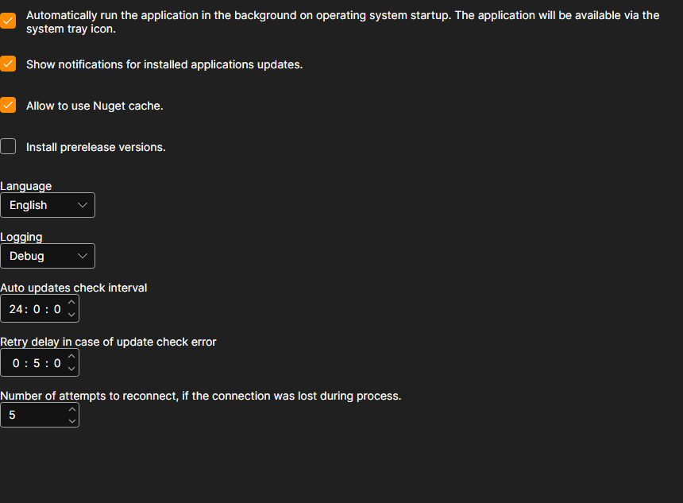

# Settings

The **Settings** page is opened with the tab of the same name at the top of the [Installer](../installer.md) window.

## What can be changed here

- **Automatically run the application in the background on operating system startup.** [Installer](../installer.md) starts together with Windows and stays in the notification area, from where it has to be closed — the cross in the window does not shut the program down.
- **Show notifications for installed applications updates.** Without this check box, [Installer](../installer.md) keeps checking for updates, but silently: you can only learn about them on the applications page. See [Update apps](update_apps.md) for how it looks.
- **Allow to use Nuget cache.** Packages already downloaded on this machine are taken from the disk instead of the network. This speeds up a repeated installation; turn it off if you need to be sure the package is downloaded again.
- **Install prerelease versions.** Besides the regular releases, preliminary builds are offered. Turn it on only if you understand why you need a version that has not been released yet.
- **Language.** The interface language of [Installer](../installer.md) itself.
- **Logging.** How detailed the log is. The records are shown on the [Logs](logs.md) page; when contacting support, a detailed level helps to find the cause faster.
- **Auto updates check interval.** How often [Installer](../installer.md) asks the server about new versions, in hours.
- **Retry delay in case of update check error.** How long to wait before repeating a failed download, in minutes.
- **Number of attempts to reconnect, if the connection was lost during process.** How many times [Installer](../installer.md) tries to finish downloading a package before reporting an error.

The changes are applied at once and saved — there is no separate save button.

## See also

[Logs](logs.md)
