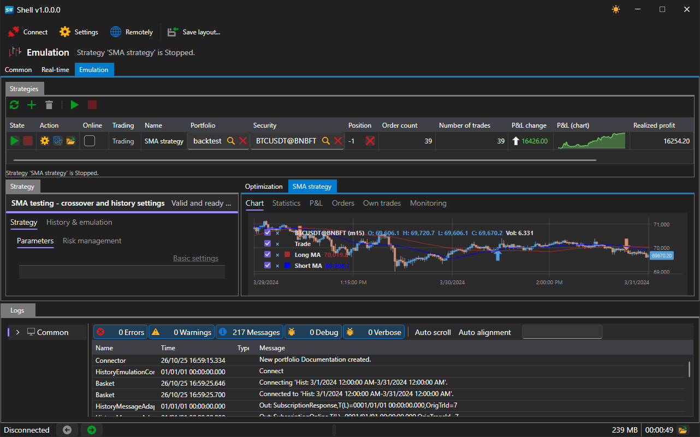

# Shell

**Shell** is a ready-made graphical framework of a trading terminal with fully open C# source code. It is built on [Avalonia](https://avaloniaui.net/) and runs on Windows, Linux and macOS.

You do not need to spend time creating a GUI (Graphical User Interface): connecting to data sources, tables of portfolios, instruments, orders and trades, charts, backtesting, parameter optimization and the work log are already included. All that is left is to write the strategy itself.

## Main features

1. Full source code, suitable for custom trading robots and custom solutions.
2. **Support for more than 70 connections** to exchanges and brokers through [Connectors](api/connectors.md).
3. Four workspaces switched by the side panel: [Common](shell/user_interface/common.md), [Real-time](shell/user_interface/real_time.md), [Emulation](shell/user_interface/emulation.md) and [Logs](shell/user_interface/log.md).
4. A flexible interface: all panels inside a workspace can be dragged, split, undocked into a separate window and docked back. The layout is saved between launches.
5. Backtesting of strategies with statistics, a trades chart and an equity curve.
6. [Optimization](shell/user_interface/optimization.md) - iterating over the strategy parameters on the same history.
7. Saving and restoring strategy settings, including risk rules.
8. Parallel launch of several strategies: each one lives its own life and has its own orders, trades and statistics.
9. Launching strategies built in [Designer](designer.md) without writing code.
10. [Remote control](shell/remote_control.md) - starting and stopping strategies from the website or from the Telegram bot.

## Bundled strategies

Shell comes with four strategies that can be launched right after the start:

| Strategy | What it does |
|---|---|
| **SMA strategy** | crossover of the short and long moving averages |
| **SMA Index strategy** | the same, but on a synthetic instrument defined by an expression |
| **StairsTrend strategy** | entry with the trend after several candles in a row in one direction |
| **StairsCountertrend strategy** | entry against the trend in the same situation |

## Recommended content

[Installing Shell](shell/installing_shell.md)

[Quick start](shell/quick_start.md)
